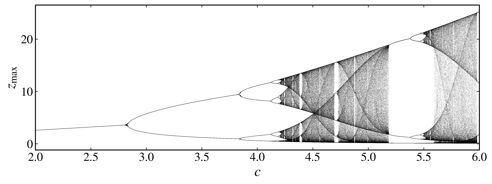
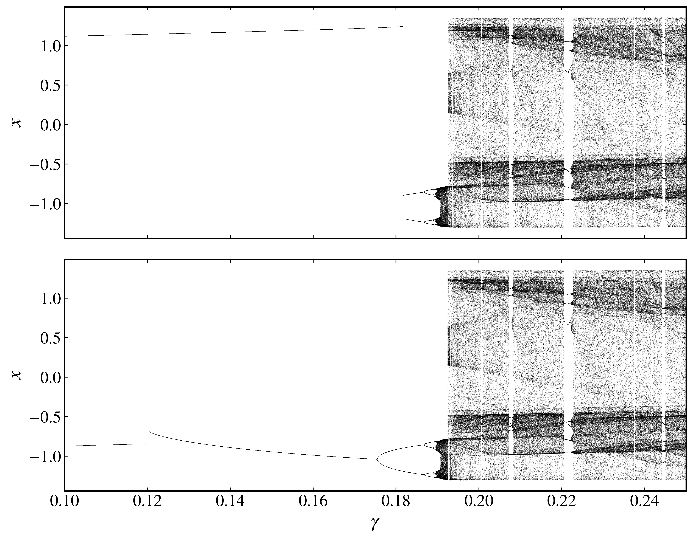

Bifurcation diagrams
--------------------

A bifurcation diagram shows how the long-term behavior of a flow changes as a parameter varies. The :py:meth:`bifurcation_diagram <pynamicalsys.core.continuous_dynamical_systems.ContinuousDynamicalSystem.bifurcation_diagram>` method sweeps one parameter and, at each value, discards a transient and records one coordinate of a reduced map: a Poincaré section with ``map_type="PS"``, a stroboscopic map with ``map_type="SM"``, or a maxima map with ``map_type="MM"``. Each map is computed as by the methods described in :doc:`cds_reduced_maps`.

Rössler system
~~~~~~~~~~~~~~

The Rössler system is

.. math::

    \begin{aligned}
        \dot{x} &= -y-z, \\
        \dot{y} &= x+ay, \\
        \dot{z} &= b+z(x-c).
    \end{aligned}

Its parameter order is ``[a, b, c]``. Hold :math:`a=b=0.2` and sweep 3000 values of :math:`c` from 2 to 6, recording 400 maxima of :math:`z` at each value:

.. code-block:: python

    import numpy as np
    import matplotlib.pyplot as plt
    from pynamicalsys import ContinuousDynamicalSystem as cds, PlotStyler

    system = cds(model="rossler system")
    system.set_parameters([0.2, 0.2, 0.0])
    system.integrator("rk4", time_step=0.01)

    parameter_range = (2.0, 6.0, 3_000)
    parameter_values, z_maxima = system.bifurcation_diagram(
        u=[1.0, 1.0, 0.0],
        param_index=2,
        param_range=parameter_range,
        num_intersections=400,
        map_type="MM",
        maxima_index=2,
        transient_time=1_000.0,
    )

The third entry of the stored parameters is a placeholder, replaced by every value of the sweep. ``parameter_values`` has shape ``(3000,)`` and ``z_maxima`` has shape ``(3000, 400)``. With a maxima map, the recorded coordinate defaults to ``maxima_index``. Every parameter value starts from ``u``, so the values are independent and are computed in parallel.

Repeat each parameter value once for every recorded maximum, then flatten the maxima for plotting:

.. code-block:: python

    parameter_plot = np.repeat(parameter_values, z_maxima.shape[1])
    observable_plot = z_maxima.ravel()

    ps = PlotStyler()
    ps.apply_style()
    fig, ax = plt.subplots(figsize=(10, 4))
    ax.scatter(parameter_plot, observable_plot, color="black", s=0.05, edgecolor="none")
    ax.set_xlim(parameter_range[0], parameter_range[1])
    ax.set_xlabel("$c$")
    ax.set_ylabel(r"$z_{\max}$")
    fig.tight_layout()
    plt.show()

    Bifurcation diagram of the maxima of :math:`z` in the Rössler system with :math:`a=b=0.2`.

The single maximum of the periodic orbit splits as :math:`c` grows, and the sequence of splittings ends in a chaotic band interrupted by periodic windows.

Following branches with continuation
~~~~~~~~~~~~~~~~~~~~~~~~~~~~~~~~~~~~~

The forced Duffing oscillator

.. math::

    \ddot{x}+\delta\dot{x}-\alpha x+\beta x^3=\gamma\cos(\omega t)

has parameter order ``[delta, alpha, beta, gamma, omega]``. Sample it once per forcing period :math:`T=2\pi/\omega` and sweep the forcing amplitude :math:`\gamma`. With ``continuation=True``, each parameter value starts from the state at the last map point of the previous one, so the sweep follows one attractor as long as it exists. Sweep :math:`\gamma` upward and then downward:

.. code-block:: python

    import numpy as np
    import matplotlib.pyplot as plt
    from pynamicalsys import ContinuousDynamicalSystem as cds, PlotStyler

    system = cds(model="duffing")
    omega = 1.1
    system.set_parameters([0.2, 1.0, 1.0, 0.0, omega])
    system.integrator("rk4", time_step=0.01)
    forcing_period = 2.0 * np.pi / omega

    sweeps = []
    for parameter_range in [(0.10, 0.25, 3_000), (0.25, 0.10, 3_000)]:
        sweeps.append(
            system.bifurcation_diagram(
                u=[1.0, 0.0],
                param_index=3,
                param_range=parameter_range,
                num_intersections=400,
                map_type="SM",
                sampling_time=forcing_period,
                transient_time=100 * forcing_period,
                continuation=True,
            )
        )

The order of ``start`` and ``stop`` in ``param_range`` sets the direction of the sweep. The integration time restarts at zero for each parameter value, so the transient is a whole number of forcing periods and every value starts at the same phase of the forcing. With a stroboscopic map, the recorded coordinate defaults to the first one, :math:`x`. The values are computed in order, one after the other.

.. code-block:: python

    ps = PlotStyler()
    ps.apply_style()
    fig, ax = plt.subplots(2, 1, figsize=(10, 8), sharex=True)
    for axis, (parameter_values, x_samples) in zip(ax, sweeps):
        parameter_plot = np.repeat(parameter_values, x_samples.shape[1])
        axis.scatter(parameter_plot, x_samples.ravel(), color="black", s=0.05, edgecolor="none")
        axis.set_ylabel("$x$")
    ax[0].set_xlim(0.10, 0.25)
    ax[1].set_xlabel(r"$\gamma$")
    fig.tight_layout()
    plt.show()

    Stroboscopic bifurcation diagrams of the Duffing oscillator with :math:`\delta=0.2`, :math:`\alpha=\beta=1`, and :math:`\omega=1.1`, sweeping :math:`\gamma` upward (top) and downward (bottom).

Between about :math:`\gamma=0.12` and :math:`\gamma=0.18`, several attractors coexist. The upward sweep stays on the upper branch until it disappears, while the downward sweep follows the other branch, through its period doublings, until it disappears near :math:`\gamma=0.12`. Without continuation, every value starts from ``u`` and lands on either attractor, so the diagram mixes both. Set ``return_last_state=True`` to also return the state at the last map point of the sweep, which can start another sweep.

Poincaré sections
~~~~~~~~~~~~~~~~~

A Poincaré section is selected with ``map_type="PS"`` and the same ``section_index``, ``section_value``, and ``crossing`` arguments as :py:meth:`poincare_section <pynamicalsys.core.continuous_dynamical_systems.ContinuousDynamicalSystem.poincare_section>`. The section coordinate is constant on the section, so the recorded coordinate defaults to the first coordinate other than ``section_index``. For example, to record :math:`y` on the upward crossings of :math:`x=0` in the Rössler system:

.. code-block:: python

    system = cds(model="rossler system")
    system.set_parameters([0.2, 0.2, 0.0])
    system.integrator("rk4", time_step=0.01)

    parameter_values, y_section = system.bifurcation_diagram(
        u=[1.0, 1.0, 0.0],
        param_index=2,
        param_range=(2.0, 6.0, 3_000),
        num_intersections=400,
        map_type="PS",
        section_index=0,
        section_value=0.0,
        crossing=1,
        transient_time=1_000.0,
    )

Pass ``observable_index`` to record another coordinate with any of the three maps.

Numerical options
~~~~~~~~~~~~~~~~~

``num_intersections`` and ``transient_time``
    The number of map points recorded at each parameter value and the integration time discarded before them. The transient must be long enough for the orbit to reach its attractor at every parameter value, in particular near bifurcation points, where the approach is slow. With continuation, each value already starts near an attractor, so a shorter transient usually suffices.

``map_type`` and its arguments
    ``map_type`` is required. ``"PS"`` needs ``section_index``, ``section_value``, and ``crossing``; ``"SM"`` needs ``sampling_time``; ``"MM"`` needs ``maxima_index``. The map points are interpolated as described in :doc:`cds_reduced_maps`.

``observable_index``
    Index of the state coordinate recorded at each map point. It defaults to ``maxima_index`` for ``"MM"``, to the first coordinate other than ``section_index`` for ``"PS"``, and to ``0`` for ``"SM"``.

``continuation`` and ``return_last_state``
    With ``continuation=True``, each parameter value starts from the state at the last map point of the previous one, and the values are computed in order instead of in parallel. With ``return_last_state=True``, the state at the last map point of the whole sweep is also returned.

``time_step``, ``atol``, and ``rtol``
    Set with ``integrator``. With ``rk45``, the initial step is estimated at each parameter value from its starting state, as in the reduced-map methods.
