Billiards
---------

A billiard is a point particle that moves in straight lines inside a closed region and reflects specularly at its boundary. The :py:class:`Billiard <pynamicalsys.core.billiards.Billiard>` class describes it as a discrete map from one collision to the next. It inherits from :py:class:`DiscreteDynamicalSystem <pynamicalsys.core.discrete_dynamical_systems.DiscreteDynamicalSystem>`, so all the methods of that class work on a billiard, with these exceptions:

- ``classify_orbit`` and ``rotation_number`` need a frequency map, and a billiard does not have one unless you set it with ``set_frequency_map``. Without it, ``classify_orbit`` raises an error, and ``rotation_number`` falls back on its deprecated computation with a ``DeprecationWarning``.
- ``available_models`` lists the models of ``DiscreteDynamicalSystem``. Use ``available_billiards`` for the billiards.
- ``diffusion_coefficient``, ``mean_squared_displacement``, and ``root_mean_squared`` run, but the position and the angle are bounded, so their results do not describe diffusion.

The billiard map
~~~~~~~~~~~~~~~~

By default, the state after a collision is :math:`(q,\alpha)`. Here, :math:`q` locates the collision on the boundary, and :math:`\alpha\in(0,\pi)` is the angle between the outgoing velocity and the tangent of the boundary, with the tangent pointing counterclockwise along the outer boundary. A trajectory that leaves perpendicular to the boundary has :math:`\alpha=\pi/2`, and values near :math:`0` or :math:`\pi` are nearly tangent to it. On a boundary :math:`R(\theta)`, such as the oval below, :math:`q` is the polar angle :math:`\theta`. The next figure shows these angles at two consecutive collisions, as in Fig. 2(a) of `Sales et al. (2024) <https://doi.org/10.1063/5.0222215>`_. There, :math:`\phi` is the angle of the tangent, so the particle leaves in the direction :math:`\phi+\alpha`.

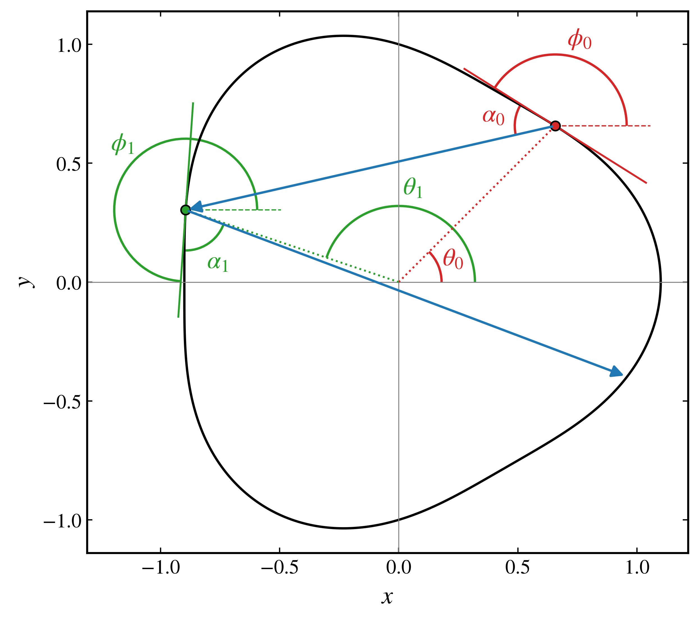

    Two collisions on the oval with :math:`\varepsilon=0.1` and :math:`p=3`. At each one, :math:`\theta` is the polar angle, :math:`\phi` the angle of the tangent, and :math:`\alpha` the angle from the tangent to the outgoing velocity.

The map preserves the measure

.. math::

    \mathrm{d}\mu=\sin\alpha\,\mathrm{d}s\,\mathrm{d}\alpha,

where :math:`s` is the arc length, and not the area in :math:`(q,\alpha)`. With ``coordinates="birkhoff"``, the state is :math:`(s,\cos\alpha)`. These coordinates are canonical, so the map preserves area in them.

.. code-block:: python

    import numpy as np
    import matplotlib.pyplot as plt
    from pynamicalsys import Billiard, PlotStyler

    angles = Billiard("oval", parameters=[0.08, 3], solver="circle")
    birkhoff = Billiard(
        "oval",
        parameters=[0.08, 3],
        solver="circle",
        coordinates="birkhoff",
    )
    perimeter = birkhoff.perimeter()

    rng = np.random.default_rng(13)
    num_orbits = 60
    fractions = rng.uniform(0.0, 1.0, num_orbits)
    cosines = rng.uniform(-0.95, 0.95, num_orbits)

    ps = PlotStyler(fontsize=16)
    ps.apply_style()
    fig, ax = plt.subplots(1, 2, figsize=(12, 4.5))
    for fraction, cosine in zip(fractions, cosines):
        orbit = angles.trajectory(
            [2.0 * np.pi * fraction, np.arccos(cosine)], 5000
        )
        ax[0].plot(orbit[:, 0], orbit[:, 1], "o", ms=0.3, mew=0, color="k")
        orbit = birkhoff.trajectory([perimeter * fraction, cosine], 5000)
        ax[1].plot(orbit[:, 0], orbit[:, 1], "o", ms=0.3, mew=0, color="k")
    ax[0].set_xlim(0.0, 2.0 * np.pi)
    ax[0].set_ylim(0.0, np.pi)
    ax[0].set_xlabel(r"$\theta$")
    ax[0].set_ylabel(r"$\alpha$")
    ax[1].set_xlim(0.0, perimeter)
    ax[1].set_ylim(-1.0, 1.0)
    ax[1].set_xlabel("$s$")
    ax[1].set_ylabel(r"$\cos\alpha$")
    fig.tight_layout()
    plt.show()

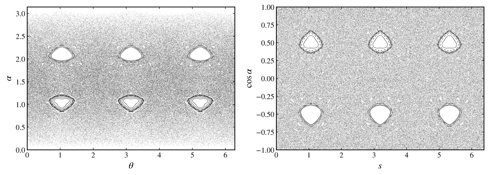

    Phase space of the oval billiard with :math:`\varepsilon=0.08` and :math:`p=3`, in :math:`(\theta,\alpha)` and in Birkhoff coordinates.

Built-in billiards
~~~~~~~~~~~~~~~~~~

``Billiard.available_billiards()`` lists the built-in boundaries. Their parameters are given in the order below.

``"oval"``
    The family :math:`R(\theta)=1+\varepsilon\cos(p\theta)`, with parameters ``[eps, p]``, :math:`\varepsilon\in[0,1]`, and integer :math:`p`, studied by `Leonel and Dettmann (2012) <https://doi.org/10.1016/j.physleta.2012.03.056>`_ and `Hansen et al. (2018) <https://doi.org/10.1016/j.chaos.2017.11.036>`_, among others. The position is :math:`\theta`. With :math:`\varepsilon=1` and :math:`p>1`, it meets the origin at :math:`p` points that separate closed lobes.

``"stadium"``
    The billiard of `Bunimovich (1979) <https://doi.org/10.1007/BF01197884>`_: semicircles of radius ``r`` joined by straight segments of length ``l``, with parameters ``[r, l]``. The position is the arc length, from the start of the right semicircle.

``"sinai"``
    A disk of radius ``r`` centered at ``(x_d, y_d)`` in the unit square, after `Sinai (1970) <https://doi.org/10.1070/RM1970v025n02ABEH003794>`_, with parameters ``[r, x_d, y_d]``. The position is the arc length, along the walls from the origin and then around the disk from its rightmost point. The boundary has two separate parts, so the position does not wrap.

``"mushroom"``
    The billiard of `Bunimovich (2001) <https://doi.org/10.1063/1.1418763>`_: a semicircular hat of radius ``R`` on a centered stem of width ``w`` and height ``h``, with parameters ``[R, w, h]``. The position is the arc length, from the bottom left of the stem.

Each billiard has different kinds of orbit. The next figure shows three in each, and `Phase spaces`_ shows the same orbits, with the same colors.

.. code-block:: python

    import numpy as np
    import matplotlib.pyplot as plt
    from pynamicalsys import Billiard, PlotStyler

    billiards = {
        "Oval": Billiard("oval", parameters=[0.1, 2], solver="circle"),
        "Stadium": Billiard(
            "stadium", parameters=[1.0, 2.0], solver="exact"
        ),
        "Sinai": Billiard(
            "sinai", parameters=[0.2, 0.5, 0.5], solver="exact"
        ),
        "Mushroom": Billiard(
            "mushroom", parameters=[1.0, 0.5, 1.0], solver="exact"
        ),
    }

    # The name, initial state, and number of collisions of each orbit.
    orbits = {
        "Oval": [
            ("Island", [np.pi / 2.0 + 0.1, np.pi / 2.0], 3000),
            ("Whispering gallery", [0.0, 0.22], 3000),
            ("Chaotic", [2.0, 1.0], 200_000),
        ],
        "Stadium": [
            ("Bouncing ball", [np.pi + 1.0, np.pi / 2.0], 2),
            ("Sticky", [np.pi + 1.0, np.pi / 2.0 + 0.01], 300),
            ("Chaotic", [1.0, 1.0], 200_000),
        ],
        "Sinai": [
            ("Bouncing ball", [0.1, np.pi / 2.0], 2),
            ("Sticky", [0.1, np.pi / 2.0 + 0.003], 300),
            ("Chaotic", [0.3, 1.0], 200_000),
        ],
        "Mushroom": [
            ("Regular", [2.95, np.arccos(0.4)], 3000),
            ("Bouncing ball", [1.0, np.pi / 2.0], 2),
            ("Chaotic", [2.95, np.arccos(0.1)], 200_000),
        ],
    }
    colors = ["tab:blue", "tab:orange", "tab:green"]

    ps = PlotStyler(fontsize=14)
    ps.apply_style()
    fig, ax = plt.subplots(3, 4, figsize=(13, 9))
    for j, (name, billiard) in enumerate(billiards.items()):
        boundary = billiard.boundary()
        for i, (label, state, collisions) in enumerate(orbits[name]):
            shown = min(collisions, 120)
            trajectory = billiard.trajectory(state, shown)
            # The start of the orbit, so a short orbit also closes.
            points = np.vstack(
                (
                    billiard.to_cartesian(state),
                    billiard.to_cartesian(trajectory),
                )
            )
            ax[i, j].plot(boundary[:, 0], boundary[:, 1], "k", lw=1.2)
            width = 1.5 if collisions == 2 else 0.6
            ax[i, j].plot(
                points[:, 0], points[:, 1], lw=width, color=colors[i]
            )
            ax[i, j].set_aspect("equal")
            ax[i, j].set_xticks([])
            ax[i, j].set_yticks([])
            ax[i, j].set_title(f"{name}: {label}", fontsize=13)
    fig.tight_layout()
    plt.show()

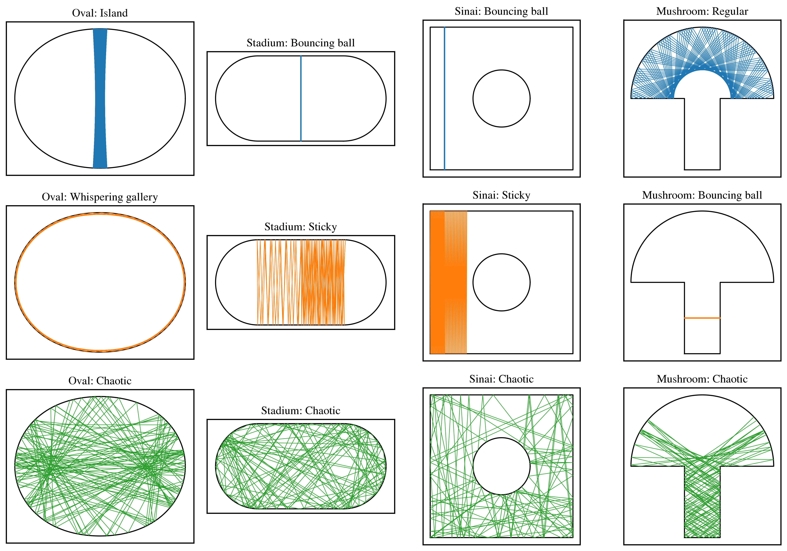

    Three kinds of orbit in each billiard, with at most 120 collisions. The oval has :math:`\varepsilon=0.1` and :math:`p=2`.

The **cardioid** is the oval with :math:`\varepsilon=1` and :math:`p=1`. It has a cusp at :math:`\theta=\pi`, where a reflection is not defined, as at a corner.

.. code-block:: python

    import numpy as np
    import matplotlib.pyplot as plt
    from pynamicalsys import Billiard, PlotStyler

    billiard = Billiard("oval", parameters=[1.0, 1.0], solver="exact")
    boundary = billiard.boundary()
    state = [1.0, 1.0]
    points = billiard.to_cartesian(billiard.trajectory(state, 150))
    orbit = billiard.trajectory(state, 200_000)

    ps = PlotStyler(fontsize=16)
    ps.apply_style()
    fig, ax = plt.subplots(1, 2, figsize=(10, 4))
    ax[0].plot(points[:, 0], points[:, 1], lw=0.5, color="tab:blue")
    ax[0].plot(boundary[:, 0], boundary[:, 1], "k", lw=1.2)
    ax[0].set_aspect("equal")
    ax[0].set_xticks([])
    ax[0].set_yticks([])
    ax[1].plot(
        orbit[:, 0], orbit[:, 1], "o", ms=0.25, mew=0, color="tab:blue"
    )
    ax[1].set_xlim(0.0, 2.0 * np.pi)
    ax[1].set_ylim(0.0, np.pi)
    ax[1].set_xlabel(r"$\theta$")
    ax[1].set_ylabel(r"$\alpha$")
    fig.tight_layout()
    plt.show()

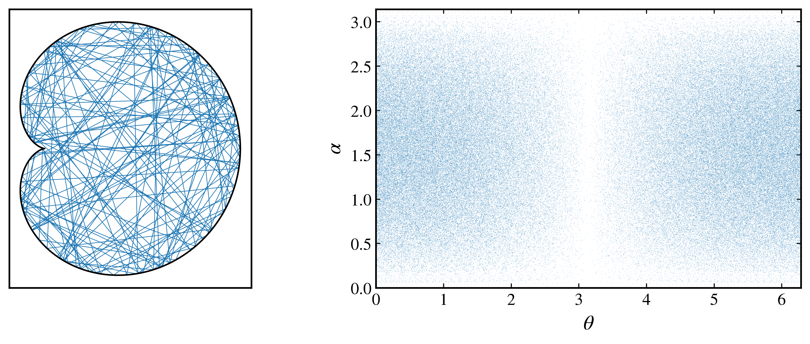

    A trajectory in the cardioid, and its phase space.

Phase spaces
~~~~~~~~~~~~

These are the orbits of the gallery. A periodic orbit is a few points, a regular orbit lies on curves, and a chaotic orbit spreads over a region. The oval, here with :math:`\varepsilon=0.1` and :math:`p=2`, also has invariant curves that span all of :math:`\theta` at small :math:`\alpha`. Orbits on these curves stay close to the boundary, and are called **whispering gallery orbits**. A sticky orbit stays close to a periodic family for many collisions before it joins the chaotic region. Such regions fill slowly: in the mushroom, the white band at :math:`\alpha\approx\pi/2` on the walls of the stem belongs to the chaotic region, and needs far more than these :math:`2\times10^5` collisions to fill.

.. code-block:: python

    import numpy as np
    import matplotlib.pyplot as plt
    from pynamicalsys import Billiard, PlotStyler

    billiards = {
        "Oval": Billiard("oval", parameters=[0.1, 2], solver="circle"),
        "Stadium": Billiard(
            "stadium", parameters=[1.0, 2.0], solver="exact"
        ),
        "Sinai": Billiard(
            "sinai", parameters=[0.2, 0.5, 0.5], solver="exact"
        ),
        "Mushroom": Billiard(
            "mushroom", parameters=[1.0, 0.5, 1.0], solver="exact"
        ),
    }

    # The name, initial state, and number of collisions of each orbit.
    orbits = {
        "Oval": [
            ("Island", [np.pi / 2.0 + 0.1, np.pi / 2.0], 3000),
            ("Whispering gallery", [0.0, 0.22], 3000),
            ("Chaotic", [2.0, 1.0], 200_000),
        ],
        "Stadium": [
            ("Bouncing ball", [np.pi + 1.0, np.pi / 2.0], 2),
            ("Sticky", [np.pi + 1.0, np.pi / 2.0 + 0.01], 300),
            ("Chaotic", [1.0, 1.0], 200_000),
        ],
        "Sinai": [
            ("Bouncing ball", [0.1, np.pi / 2.0], 2),
            ("Sticky", [0.1, np.pi / 2.0 + 0.003], 300),
            ("Chaotic", [0.3, 1.0], 200_000),
        ],
        "Mushroom": [
            ("Regular", [2.95, np.arccos(0.4)], 3000),
            ("Bouncing ball", [1.0, np.pi / 2.0], 2),
            ("Chaotic", [2.95, np.arccos(0.1)], 200_000),
        ],
    }
    colors = ["tab:blue", "tab:orange", "tab:green"]

    ps = PlotStyler(fontsize=16)
    ps.apply_style()
    fig, ax = plt.subplots(2, 2, figsize=(12, 7), sharey=True)
    for axis, (name, billiard) in zip(ax.flat, billiards.items()):
        # The chaotic orbit first, so it does not hide the others.
        for i, (label, state, collisions) in reversed(
            list(enumerate(orbits[name]))
        ):
            orbit = billiard.trajectory(state, collisions)
            size = (
                0.25
                if label == "Chaotic"
                else 1.0 if collisions > 2 else 7.0
            )
            axis.plot(
                orbit[:, 0],
                orbit[:, 1],
                "o",
                ms=size,
                mew=0,
                color=colors[i],
                label=label,
            )
        axis.set_xlim(0.0, billiard.info["period"] or billiard.perimeter())
        axis.set_ylim(0.0, np.pi)
        axis.set_title(name)
        axis.set_xlabel(r"$\theta$" if name == "Oval" else "$s$")
    for axis in ax[:, 0]:
        axis.set_ylabel(r"$\alpha$")
    fig.tight_layout()
    plt.show()

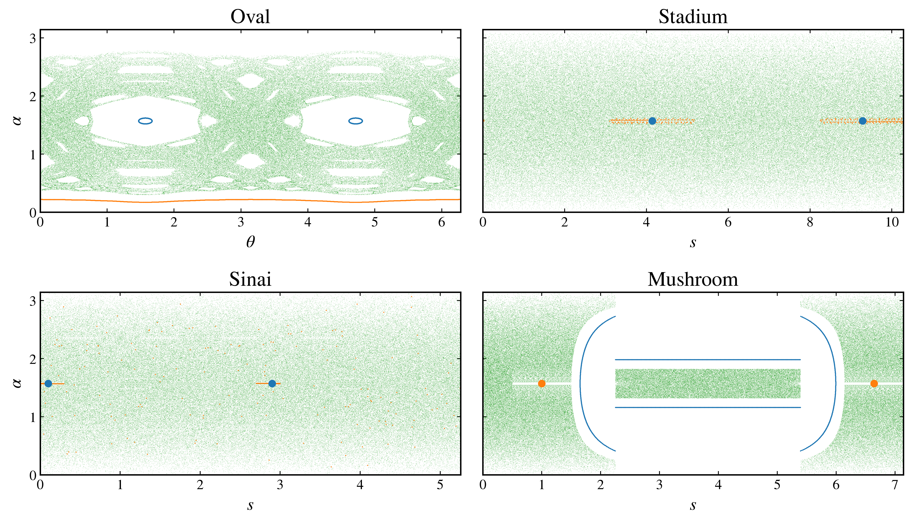

    Phase spaces of the orbits of the gallery, with the same colors. The orange curve in the oval is the whispering gallery orbit.

Choosing a solver
~~~~~~~~~~~~~~~~~

``solver`` is a required argument that selects the method used to find the next collision. It has no default because the fastest valid method depends on the boundary, and a method used outside its range can return a wrong collision. There are four methods:

``"md"``
    Molecular dynamics. The particle advances in small steps until it is outside the billiard, and bisection then locates the collision. It works on every billiard and is the slowest method. A large step can miss a collision.

``"exact"``
    Closed-form intersections, for boundaries made of lines and arcs, and for the oval with :math:`p=1`, where the collision is a root of a cubic.

``"circle"``
    The tangent method, with a seed on a circle around the billiard (Algorithm 1 of `da Costa et al., 2022 <https://doi.org/10.1142/S0218127422500523>`_, also used by `Sales et al., 2024 <https://doi.org/10.1063/5.0222215>`_). It requires a convex boundary :math:`R(\theta)`.

``"polygon"``
    The tangent method, with a seed on a polygon around one wedge of the billiard (Algorithm 2 of `da Costa et al., 2022 <https://doi.org/10.1142/S0218127422500523>`_). It uses the formula of the oval, so no other boundary has it, and it requires :math:`p\ge2`.

By kind of boundary
^^^^^^^^^^^^^^^^^^^

.. list-table::
    :header-rows: 1

    * - Boundary
      - Examples
      - Solver
      - Limits
    * - Lines and arcs
      - stadium, Sinai, mushroom, ``from_pieces``
      - ``exact``
      - None on a static boundary
    * - Convex :math:`R(\theta)`
      - ``from_polar`` with ``max_radius``, oval with :math:`\varepsilon\le1/(1+p^2)`
      - ``circle``
      - Wrong on a boundary that is not convex
    * - Non-convex :math:`R(\theta)`
      - ``from_polar``
      - ``md``
      - A large step can miss a collision
    * - Oval, :math:`p=1`
      - any :math:`\varepsilon`, including the cardioid
      - ``exact``
      - :math:`p=1` only
    * - Non-convex oval, :math:`p\ge2`
      - :math:`1/(1+p^2)<\varepsilon<1`
      - ``polygon``
      - Oval only
    * - Oval, :math:`\varepsilon=1`, :math:`p>1`
      - separate lobes
      - ``md``
      - A large step can miss a collision

Every boundary also accepts ``md``. A solver outside its range raises an error when it can detect this, and the message names the alternatives. `Defining your own billiard`_ describes what can go undetected.

By kind of problem
^^^^^^^^^^^^^^^^^^

**Long orbits, ensembles, and basins.** Use the fastest valid solver. The gain is largest on :math:`R(\theta)` boundaries, where molecular dynamics evaluates the boundary at each step, and smallest on lines and arcs, where testing a point is cheap. The next benchmark compares both on one chaotic orbit. A short preliminary call excludes just-in-time compilation from the measurements. Absolute times depend on the processor and software environment.

.. code-block:: python

    from time import perf_counter

    import numpy as np
    import matplotlib.pyplot as plt
    from pynamicalsys import Billiard, PlotStyler
    from numba import njit

    @njit
    def radius(theta, parameters):
        return 1.0 + 0.02 * np.cos(2.0 * theta) + 0.01 * np.sin(5.0 * theta)

    @njit
    def dradius(theta, parameters):
        return -0.04 * np.sin(2.0 * theta) + 0.05 * np.cos(5.0 * theta)

    @njit
    def max_radius(parameters):
        return 1.03

    def polar(solver):
        return Billiard.from_polar(
            radius, dradius, max_radius=max_radius, solver=solver
        )

    def builtin(name, parameters):
        return lambda solver: Billiard(
            name, parameters=parameters, solver=solver
        )

    # The name, how to build it, its fast solver, and the initial state.
    cases = [
        ("Convex\nfrom_polar", polar, "circle", [1.0, 1.0]),
        (
            "Oval\n$\\varepsilon=0.08$",
            builtin("oval", [0.08, 3]),
            "circle",
            [2.0, 1.0],
        ),
        (
            "Oval\n$\\varepsilon=0.4$",
            builtin("oval", [0.4, 3]),
            "polygon",
            [1.3, 0.9],
        ),
        (
            "Oval\n$\\varepsilon=0.9$",
            builtin("oval", [0.9, 3]),
            "polygon",
            [1.3, 0.9],
        ),
        ("Cardioid", builtin("oval", [1.0, 1.0]), "exact", [1.0, 1.0]),
        ("Stadium", builtin("stadium", [1.0, 2.0]), "exact", [1.0, 1.0]),
        ("Sinai", builtin("sinai", [0.2, 0.5, 0.5]), "exact", [0.3, 1.0]),
        (
            "Mushroom",
            builtin("mushroom", [1.0, 0.5, 1.0]),
            "exact",
            [3.0, 1.0],
        ),
    ]

    collisions = 100_000
    repeats = 20
    times = np.empty((len(cases), 2, repeats))
    for i, (name, build, fast, state) in enumerate(cases):
        for j, solver in enumerate((fast, "md")):
            billiard = build(solver)
            billiard.trajectory(state, 1)
            for repeat in range(repeats):
                start = perf_counter()
                billiard.trajectory(state, collisions)
                times[i, j, repeat] = perf_counter() - start

    # In microseconds per collision
    mean_times = 1e6 * np.mean(times, axis=2) / collisions
    std_times = 1e6 * np.std(times, axis=2, ddof=1) / collisions

    ps = PlotStyler(fontsize=14)
    ps.apply_style()
    fig, ax = plt.subplots(figsize=(11, 4))
    positions = np.arange(len(cases))
    width = 0.4
    ax.bar(
        positions - width / 2.0,
        mean_times[:, 0],
        width,
        yerr=std_times[:, 0],
        color="darkviolet",
        edgecolor="black",
        linewidth=1.0,
        capsize=4,
        label="Fast solver",
    )
    ax.bar(
        positions + width / 2.0,
        mean_times[:, 1],
        width,
        yerr=std_times[:, 1],
        color="gold",
        edgecolor="black",
        linewidth=1.0,
        capsize=4,
        label="md (md_steps=500)",
    )
    ax.set_xticks(positions, [case[0] for case in cases])
    ax.set_ylabel(r"Time per collision ($\mu$s)")
    ax.legend(frameon=False)
    fig.tight_layout()
    plt.show()

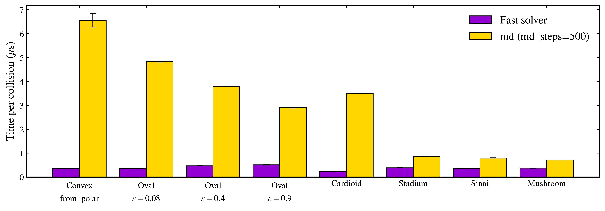

    Time per collision of the fast solver of each boundary and of molecular dynamics with ``md_steps=500``. Bars show the mean of twenty runs of :math:`10^5` collisions, and error bars show one standard deviation.

**A scan of parameters across the convexity limit.** On the oval, ``circle`` raises above :math:`\varepsilon=1/(1+p^2)`. Use ``md`` with a suitable ``md_steps`` for the whole scan, or switch to ``polygon`` above the limit.

**Checking a new boundary or a result.** Compare with ``md`` and a large ``md_steps``. Single collisions must agree. Long chaotic orbits do not, since round-off grows along them.

**Trajectories that nearly touch the boundary, and thin features.** Molecular dynamics misses a collision followed by a return to the interior within one step. The next figure reproduces Fig. 9 of da Costa et al. (2022): with ``md_steps=50``, the trajectory passes through a part of the boundary that bulges inward. The default of 500 can still miss such collisions on a strongly non-convex boundary, and larger values are safer and slower. On the mushroom, a trajectory can clip a corner within one step, so use ``exact`` there.

.. code-block:: python

    import numpy as np
    import matplotlib.pyplot as plt
    from pynamicalsys import Billiard, PlotStyler

    state = [0.55, 0.1442]

    ps = PlotStyler(fontsize=16)
    ps.apply_style()
    fig, ax = plt.subplots(1, 2, figsize=(10, 4))
    for axis, md_steps in zip(ax, [50, 500]):
        billiard = Billiard(
            "oval", parameters=[0.4, 3], solver="md", md_steps=md_steps
        )
        boundary = billiard.boundary()
        start = billiard.to_cartesian(state)
        end = billiard.to_cartesian(billiard.trajectory(state, 1)[0])
        axis.plot(boundary[:, 0], boundary[:, 1], "k", lw=1.2)
        axis.plot([start[0], end[0]], [start[1], end[1]], "r")
        axis.set_aspect("equal")
        axis.set_title(f"md_steps = {md_steps}")
    fig.tight_layout()
    plt.show()

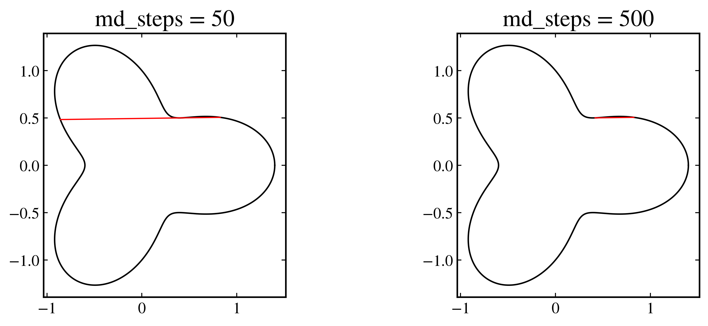

    One collision on the oval with :math:`\varepsilon=0.4` and :math:`p=3`, from :math:`\theta_0=0.55` and :math:`\alpha_0=0.1442`. The coarse step skips the first two intersections with the boundary.

Defining your own billiard
~~~~~~~~~~~~~~~~~~~~~~~~~~

From a radius
^^^^^^^^^^^^^

``Billiard.from_polar`` takes a boundary :math:`R(\theta)` that surrounds the origin and is crossed once by each ray from it. The functions must be decorated with ``@njit``, and the position is :math:`\theta`. ``ddradius`` is optional: it gives the analytic Jacobian, and without it the map is differentiated numerically. ``max_radius`` is an upper bound of the radius, which ``solver="circle"`` requires.

The radius, its derivatives, and ``max_radius`` are checked along the boundary. With ``solver="circle"``, convexity is also checked, on a grid of 5000 angles. A narrower dent can escape this check, and ``circle`` then returns wrong collisions without an error. These checks use the given or stored parameters. Parameters passed directly to ``trajectory`` and similar methods are not checked.

In Birkhoff coordinates, the arc length comes from a quadrature with ``num_panels`` panels. A boundary with sharp features needs more panels, and a ``UserWarning`` is raised when doubling them changes the perimeter.

.. code-block:: python

    import numpy as np
    import matplotlib.pyplot as plt
    from pynamicalsys import Billiard, PlotStyler
    from numba import njit

    @njit
    def radius(theta, parameters):
        a, b = parameters
        return 1.0 + a * np.cos(2.0 * theta) + b * np.sin(5.0 * theta)

    @njit
    def dradius(theta, parameters):
        a, b = parameters
        return -2.0 * a * np.sin(2.0 * theta) + 5.0 * b * np.cos(
            5.0 * theta
        )

    @njit
    def ddradius(theta, parameters):
        a, b = parameters
        return -4.0 * a * np.cos(2.0 * theta) - 25.0 * b * np.sin(
            5.0 * theta
        )

    @njit
    def max_radius(parameters):
        return 1.0 + abs(parameters[0]) + abs(parameters[1])

    functions = dict(ddradius=ddradius, max_radius=max_radius)
    nonconvex = Billiard.from_polar(
        radius, dradius, parameters=[0.1, 0.05], solver="md", **functions
    )
    convex = Billiard.from_polar(
        radius,
        dradius,
        parameters=[0.02, 0.01],
        solver="circle",
        **functions
    )
    print(nonconvex.perimeter(), convex.perimeter())

    try:
        Billiard.from_polar(
            radius,
            dradius,
            parameters=[0.1, 0.05],
            solver="circle",
            **functions
        )
    except ValueError as error:
        print(error)

    boundary = nonconvex.boundary()
    points = nonconvex.to_cartesian(nonconvex.trajectory([1.0, 1.0], 200))

    ps = PlotStyler(fontsize=16)
    ps.apply_style()
    fig, ax = plt.subplots(figsize=(5, 4))
    ax.plot(points[:, 0], points[:, 1], lw=0.5, color="tab:blue")
    ax.plot(boundary[:, 0], boundary[:, 1], "k", lw=1.2)
    ax.set_aspect("equal")
    fig.tight_layout()
    plt.show()

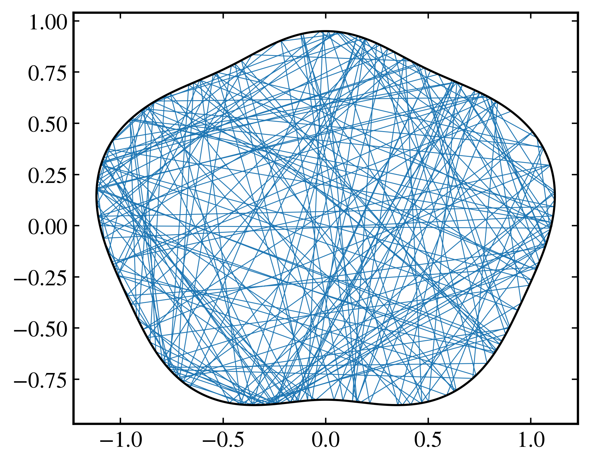

    A trajectory on a boundary defined with ``from_polar``.

From lines and arcs
^^^^^^^^^^^^^^^^^^^

``Billiard.from_pieces`` takes a list of lines and arcs, in order along the boundary. The position is the arc length in that order.

A line is ``("line", x0, y0, x1, y1)``, and runs from :math:`(x_0,y_0)` to :math:`(x_1,y_1)`.

An arc is ``("arc", center_x, center_y, radius, first_angle, span)``. Angles are in radians, measured at the center of the circle, counterclockwise from the positive :math:`x` direction. The arc starts at the point of the circle at the angle ``first_angle``, and sweeps the angle ``span``, so it ends at the angle ``first_angle + span``. A positive ``span`` runs counterclockwise, and a negative one clockwise. For example, ``first_angle=0`` and ``span=-2 * np.pi`` is a full circle, run clockwise from its rightmost point.

The direction matters: the outer boundary must run counterclockwise, and the boundary of a hole, such as a disk, clockwise.

The next example is the desymmetrized Sinai billiard: the right triangle with vertices :math:`(0,0)`, :math:`(1,0)`, and :math:`(1,1)`, one eighth of a square of side 2 with a disk at its center. A circle of radius :math:`r` centered at :math:`(0,0)` cuts the corner there. The cut runs clockwise, from the angle :math:`\pi/4` on the hypotenuse to the angle :math:`0` on the bottom side, so ``first_angle=np.pi / 4`` and ``span=-np.pi / 4``. ``Billiard.plot_pieces`` numbers the pieces and shows their directions.

.. code-block:: python

    import numpy as np
    import matplotlib.pyplot as plt
    from pynamicalsys import Billiard, PlotStyler

    r = 0.4
    corner = r / np.sqrt(2.0)  # Where the circle meets the hypotenuse
    pieces = [
        ("line", r, 0.0, 1.0, 0.0),
        ("line", 1.0, 0.0, 1.0, 1.0),
        ("line", 1.0, 1.0, corner, corner),
        ("arc", 0.0, 0.0, r, np.pi / 4.0, -np.pi / 4.0),
    ]
    billiard = Billiard.from_pieces(pieces, solver="exact")
    boundary = billiard.boundary()
    points = billiard.to_cartesian(billiard.trajectory([0.3, 1.0], 150))

    ps = PlotStyler(fontsize=16)
    ps.apply_style()
    fig, ax = plt.subplots(1, 2, figsize=(10, 4.5))
    Billiard.plot_pieces(pieces, ax=ax[0])
    ax[1].plot(points[:, 0], points[:, 1], lw=0.5, color="tab:blue")
    ax[1].plot(boundary[:, 0], boundary[:, 1], "k", lw=1.2)
    ax[1].set_aspect("equal")
    fig.tight_layout()
    plt.show()

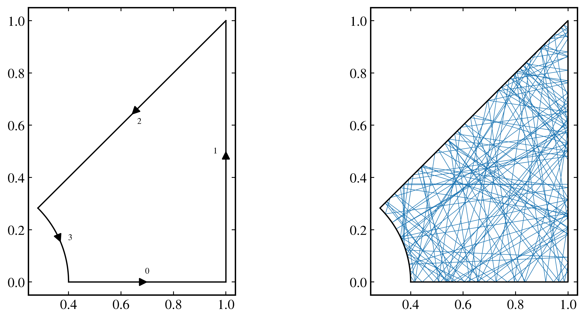

    The desymmetrized Sinai billiard with :math:`r=0.4`: its numbered pieces with their directions, and a trajectory.

A boundary that depends on parameters is a function decorated with ``@njit`` that returns a table, built with ``new_pieces``, ``set_line``, and ``set_arc``. Rows are set in order.

.. code-block:: python

    import numpy as np
    from numba import njit
    from pynamicalsys import Billiard
    from pynamicalsys.discrete_time.billiards import (
        new_pieces,
        set_arc,
        set_line,
    )

    @njit
    def desymmetrized_sinai(parameters):
        r = parameters[0]
        corner = r / np.sqrt(2.0)
        table = new_pieces(4)
        set_line(table, 0, r, 0.0, 1.0, 0.0)
        set_line(table, 1, 1.0, 0.0, 1.0, 1.0)
        set_line(table, 2, 1.0, 1.0, corner, corner)
        set_arc(table, 3, 0.0, 0.0, r, np.pi / 4.0, -np.pi / 4.0)
        return table

    billiard = Billiard.from_pieces(
        desymmetrized_sinai, parameters=[0.4], solver="exact"
    )
    print(billiard.perimeter(), billiard.perimeter([0.2]))

Invalid boundaries
^^^^^^^^^^^^^^^^^^

``from_pieces`` raises a ``ValueError`` if the pieces are not connected, if two pieces cross or touch, if the pieces run in the wrong direction, or if a hole is outside the billiard or inside another hole. A piece that doubles back over its neighbor counts as a crossing. The message names the pieces and the point, and the boundary is drawn in a figure with the problem in red. A notebook displays the figure, and a script needs ``plt.show()``.

.. code-block:: python

    import matplotlib.pyplot as plt
    from pynamicalsys import Billiard, PlotStyler

    ps = PlotStyler(fontsize=14)
    ps.apply_style()
    try:
        Billiard.from_pieces(
            [
                ("line", 0.0, 0.0, 1.0, 0.0),
                ("line", 1.0, 0.0, 1.0, 1.0),
                ("line", 1.0, 1.0, 0.0, 1.0),
            ],
            solver="exact",
        )
    except ValueError as error:
        print(error)
    plt.show()

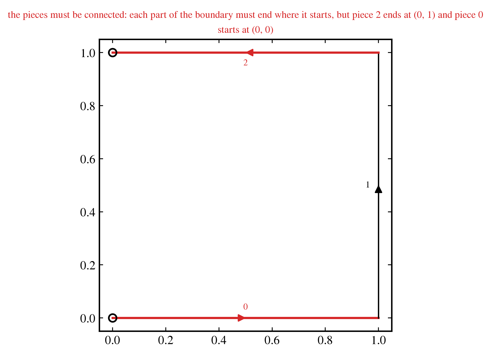

    A boundary that is not closed.

.. code-block:: python

    import numpy as np
    import matplotlib.pyplot as plt
    from pynamicalsys import Billiard, PlotStyler

    ps = PlotStyler(fontsize=14)
    ps.apply_style()
    try:
        Billiard.from_pieces(
            [
                ("line", 0.0, 0.0, 1.0, 0.0),
                ("line", 1.0, 0.0, 1.0, 1.0),
                ("line", 1.0, 1.0, 0.0, 1.0),
                ("line", 0.0, 1.0, 0.0, 0.0),
                ("arc", 0.5, 0.9, 0.2, 0.0, -2.0 * np.pi),
            ],
            solver="exact",
        )
    except ValueError as error:
        print(error)
    plt.show()

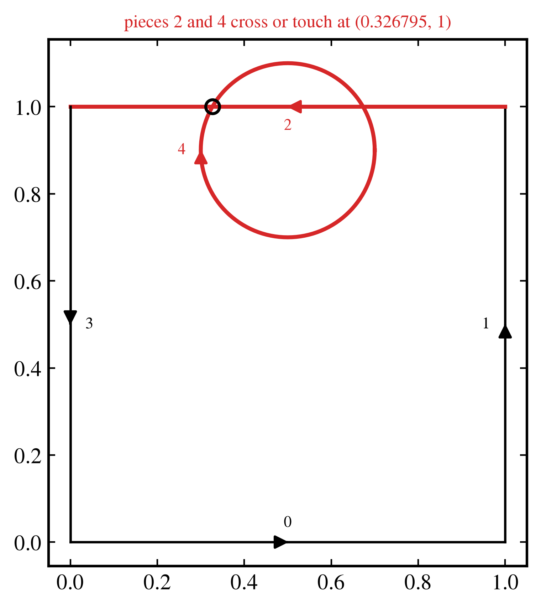

    A disk that intersects a wall.

Chaotic indicators
~~~~~~~~~~~~~~~~~~

The indicators of :doc:`Lyapunov exponents <dds_lyapunov>` and :doc:`Alignment indices <dds_alignment_indices>` work on billiards as on any map. The examples use the oval with :math:`\varepsilon=0.08` and :math:`p=3`. On a boundary from ``from_polar``, pass ``ddradius``: without it, the map is differentiated numerically, which is less accurate and slower.

Lyapunov exponents
^^^^^^^^^^^^^^^^^^

The exponents of a chaotic orbit converge to :math:`\lambda_2=-\lambda_1`. The map does not preserve area in :math:`(\theta,\alpha)`, but it does preserve :math:`\sin\alpha\,\mathrm{d}s\,\mathrm{d}\alpha`. So the sum of the exponents still goes to zero, as :math:`1/n`.

.. code-block:: python

    import numpy as np
    import matplotlib.pyplot as plt
    from pynamicalsys import Billiard, PlotStyler

    billiard = Billiard("oval", parameters=[0.08, 3], solver="circle")
    state = [2.0, 1.0]
    total_time = 1_000_000
    sample_times = np.unique(np.logspace(1, 6, 400).astype(int))
    exponents = billiard.lyapunov(
        state, total_time, return_history=True, sample_times=sample_times
    )

    ps = PlotStyler(fontsize=16)
    ps.apply_style()
    fig, ax = plt.subplots(1, 2, figsize=(12, 4))
    ax[0].plot(sample_times, exponents[:, 0], label=r"$\lambda_1$")
    ax[0].plot(sample_times, exponents[:, 1], label=r"$\lambda_2$")
    ax[0].axhline(0.0, color="gray", lw=0.8)
    ax[0].set_xscale("log")
    ax[0].set_xlabel("$n$")
    ax[0].set_ylabel(r"$\lambda$")
    ax[0].legend(frameon=False)
    ax[1].plot(sample_times, np.abs(exponents.sum(axis=1)), color="k")
    ax[1].plot(
        sample_times, 1.0 / sample_times, "--", color="gray", label="$1/n$"
    )
    ax[1].set_xscale("log")
    ax[1].set_yscale("log")
    ax[1].set_xlabel("$n$")
    ax[1].set_ylabel(r"$|\lambda_1+\lambda_2|$")
    ax[1].legend(frameon=False)
    fig.tight_layout()
    plt.show()

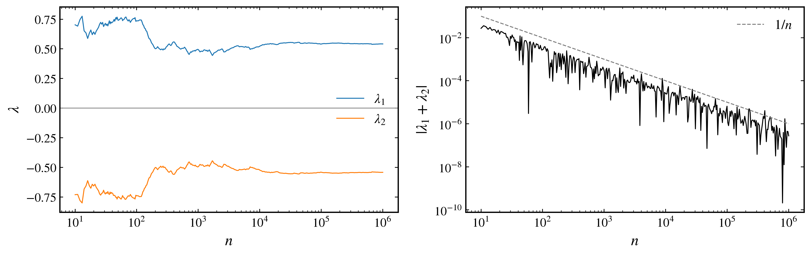

    Both exponents of a chaotic orbit against the number of collisions, and their sum.

The largest exponent separates the two kinds of orbit: it converges to a positive value on a chaotic orbit, and decays to zero on a regular one.

.. code-block:: python

    import numpy as np
    import matplotlib.pyplot as plt
    from pynamicalsys import Billiard, PlotStyler

    billiard = Billiard("oval", parameters=[0.08, 3], solver="circle")
    total_time = 1_000_000
    sample_times = np.unique(np.logspace(1, 6, 400).astype(int))
    orbits = [
        ("Chaotic", [2.0, 1.0], "tab:green"),
        ("Regular", [np.pi / 3.0 + 0.04, np.pi / 3.0], "tab:blue"),
    ]

    ps = PlotStyler(fontsize=16)
    ps.apply_style()
    fig, ax = plt.subplots(figsize=(7, 4))
    for label, state, color in orbits:
        exponents = billiard.lyapunov(
            state,
            total_time,
            return_history=True,
            sample_times=sample_times,
            num_exponents=1,
        )
        ax.plot(sample_times, exponents, color=color, label=label)
    ax.set_xscale("log")
    ax.set_yscale("log")
    ax.set_xlabel("$n$")
    ax.set_ylabel(r"$\lambda_1$")
    ax.legend(frameon=False)
    fig.tight_layout()
    plt.show()

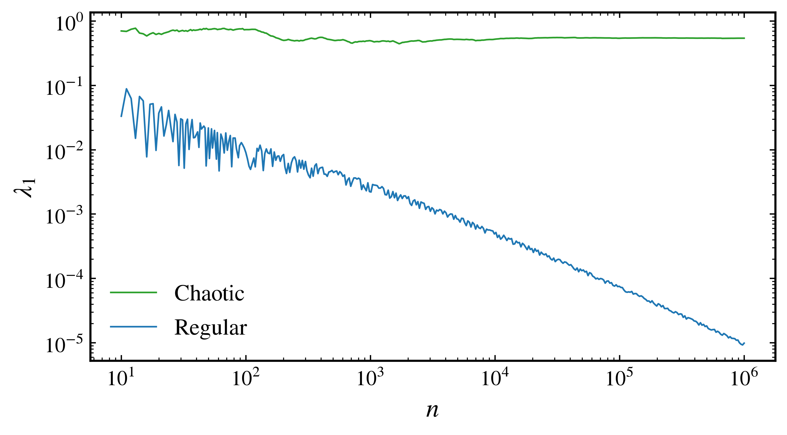

    The largest exponent of a chaotic orbit and of a regular orbit.

On a grid of initial conditions, the largest exponent shows the structure of the phase space, with the islands at :math:`\lambda_1\approx0`.

.. code-block:: python

    import numpy as np
    import matplotlib.pyplot as plt
    from pynamicalsys import Billiard, PlotStyler
    from joblib import Parallel, delayed

    billiard = Billiard("oval", parameters=[0.08, 3], solver="circle")
    grid_size = 300
    total_time = 5000
    thetas = np.linspace(0.0, 2.0 * np.pi, grid_size)
    alphas = np.linspace(0.01, np.pi - 0.01, grid_size)
    result = Parallel(n_jobs=-1)(
        delayed(billiard.lyapunov)(
            [theta, alpha], total_time, num_exponents=1
        )
        for theta in thetas
        for alpha in alphas
    )
    exponents = np.array(result).reshape(grid_size, grid_size)

    ps = PlotStyler(fontsize=16)
    ps.apply_style()
    fig, ax = plt.subplots(figsize=(8, 4))
    mesh = ax.pcolormesh(
        thetas, alphas, exponents.T, cmap="magma", shading="auto"
    )
    fig.colorbar(mesh, ax=ax, label=r"$\lambda_1$")
    ax.set_xlabel(r"$\theta$")
    ax.set_ylabel(r"$\alpha$")
    fig.tight_layout()
    plt.show()

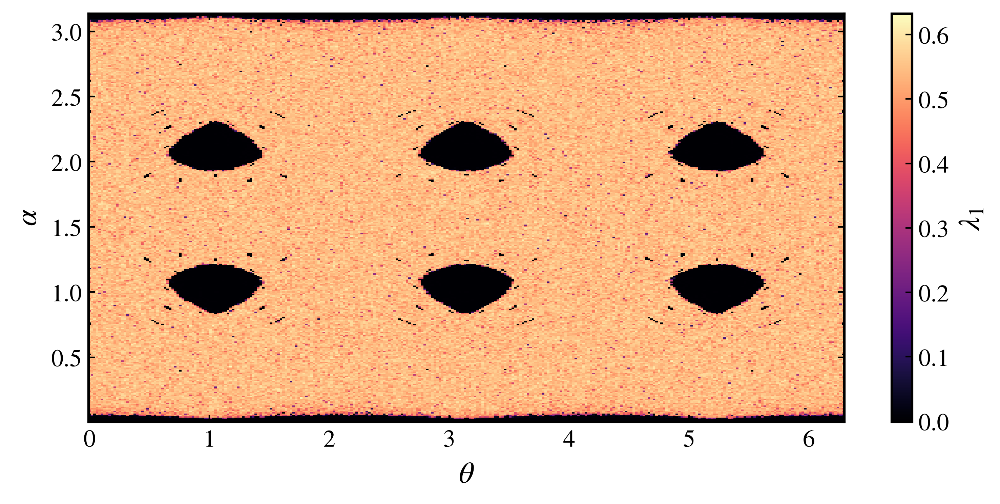

    The largest exponent after 5000 collisions on a grid of initial conditions.

Smaller Alignment Index
^^^^^^^^^^^^^^^^^^^^^^^

SALI falls exponentially to round-off on a chaotic orbit, where it stops at ``threshold``, and decays slowly on a regular orbit.

.. code-block:: python

    import numpy as np
    import matplotlib.pyplot as plt
    from pynamicalsys import Billiard, PlotStyler

    billiard = Billiard("oval", parameters=[0.08, 3], solver="circle")
    total_time = 100_000
    orbits = [
        ("Chaotic", [2.0, 1.0], "tab:green"),
        ("Regular", [np.pi / 3.0 + 0.04, np.pi / 3.0], "tab:blue"),
    ]

    ps = PlotStyler(fontsize=16)
    ps.apply_style()
    fig, ax = plt.subplots(figsize=(7, 4))
    for label, state, color in orbits:
        sali = billiard.SALI(state, total_time, return_history=True)
        n = np.arange(1, len(sali) + 1)
        ax.plot(n, sali, color=color, label=label)
    ax.set_xscale("log")
    ax.set_yscale("log")
    ax.set_xlabel("$n$")
    ax.set_ylabel("SALI")
    ax.legend(frameon=False)
    fig.tight_layout()
    plt.show()

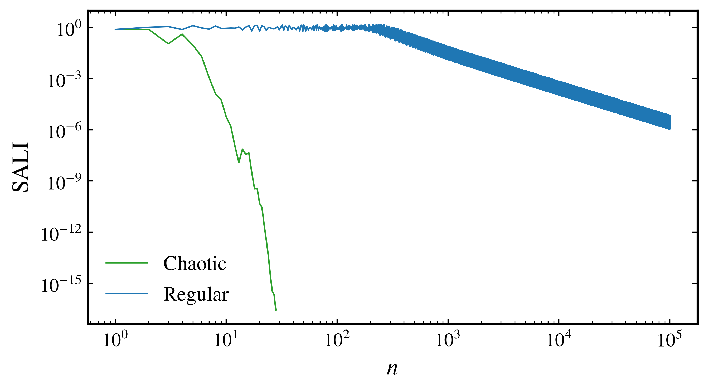

    SALI of a chaotic orbit and of a regular orbit.

Periodic orbits and their manifolds
~~~~~~~~~~~~~~~~~~~~~~~~~~~~~~~~~~~

The methods of :doc:`Periodic orbits and their manifolds <dds_manifolds>` also work on billiards. This section uses the oval with :math:`\varepsilon=0.08` and :math:`p=3`, and its code blocks continue from one another:

.. code-block:: python

    import numpy as np
    import matplotlib.pyplot as plt
    from pynamicalsys import Billiard, PlotStyler

    billiard = Billiard("oval", parameters=[0.08, 3], solver="circle")
    periods = [2.0 * np.pi, np.inf]

The first period-3 saddle
^^^^^^^^^^^^^^^^^^^^^^^^^

This oval has a triangular orbit of period 3 with :math:`\alpha=\pi/3`, near :math:`\theta=2\pi/3`. Search a rectangle that encloses it with the grid refinement, then refine the result with Newton. Since :math:`\theta` wraps, ``periods`` passes its period to both.

The largest multiplier of this orbit is about 88, which changes two options. A point of the grid is far from returning, so ``tolerance`` must be much larger than the default. Round-off also limits how well the orbit can close, so ``convergence_threshold`` must be larger than the default.

.. code-block:: python

    thetas = np.linspace(2.0, 2.2, 60)
    alphas = np.linspace(0.95, 1.15, 60)
    grid = np.stack(np.meshgrid(thetas, alphas, indexing="ij"), axis=-1)

    saddle_1 = billiard.find_periodic_orbit(
        grid, 3, tolerance=0.05, periods=periods
    )
    saddle_1 = billiard.find_periodic_orbit(
        saddle_1,
        3,
        periods=periods,
        convergence_threshold=1e-12,
        prime_period=True,
    )

    info = billiard.classify_stability(saddle_1, 3)
    print(saddle_1, info["classification"])
    print("eigenvalues:", info["eigenvalues"])

.. code-block:: text

    [2.0943951  1.04719755] saddle
    eigenvalues: [8.76182165e+01+0.0000000e+00j 1.14131517e-02-5.3163399e-50j]

The orbit is a saddle at :math:`(\theta,\alpha)=(2\pi/3,\pi/3)`: its multipliers are real, one larger than one and one smaller. Verify its period. Round-off grows by the multiplier at each return, so ``period`` needs a ``tolerance`` larger than the default, with which it returns ``-1`` here.

.. code-block:: python

    print("period:", billiard.period(saddle_1, 20000, tolerance=1e-8))
    print("is period 3:", billiard.is_periodic(saddle_1, 3))
    print("is period 1:", billiard.is_periodic(saddle_1, 1))

.. code-block:: text

    period: 3
    is period 3: True
    is period 1: False

With the saddle located, compute its manifolds:

.. code-block:: python

    unstable_1 = billiard.manifold(
        saddle_1, 3, n_points=20000, iter_time=8, stability="unstable"
    )
    stable_1 = billiard.manifold(
        saddle_1, 3, n_points=20000, iter_time=8, stability="stable"
    )

The second period-3 saddle
^^^^^^^^^^^^^^^^^^^^^^^^^^

The same triangle traveled in the opposite direction is another orbit, with :math:`\alpha=2\pi/3`. Locate and classify it in the same way:

.. code-block:: python

    alphas = np.linspace(1.99, 2.19, 60)
    grid = np.stack(np.meshgrid(thetas, alphas, indexing="ij"), axis=-1)

    saddle_2 = billiard.find_periodic_orbit(
        grid, 3, tolerance=0.05, periods=periods
    )
    saddle_2 = billiard.find_periodic_orbit(
        saddle_2,
        3,
        periods=periods,
        convergence_threshold=1e-12,
        prime_period=True,
    )

    info = billiard.classify_stability(saddle_2, 3)
    print(saddle_2, info["classification"])
    print("eigenvalues:", info["eigenvalues"])

.. code-block:: text

    [2.0943951 2.0943951] saddle
    eigenvalues: [8.76182165e+01+0.j 1.14131517e-02+0.j]

Compute its manifolds:

.. code-block:: python

    unstable_2 = billiard.manifold(
        saddle_2, 3, n_points=20000, iter_time=8, stability="unstable"
    )
    stable_2 = billiard.manifold(
        saddle_2, 3, n_points=20000, iter_time=8, stability="stable"
    )

Visualizing the orbits and manifolds
^^^^^^^^^^^^^^^^^^^^^^^^^^^^^^^^^^^^

The next figure collects both saddles and their manifolds over a chaotic orbit. To place every point of an orbit, iterate its representative point with ``trajectory``.

.. code-block:: python

    chaotic = billiard.trajectory([2.0, 1.0], 2_000_000)

    def plot_manifold(ax, branches, color):
        for branch in branches:
            ax.plot(
                branch[:, 0], branch[:, 1], "o", markersize=0.4, color=color
            )

    def plot_orbit(ax, point, period, color):
        orbit = billiard.trajectory(point, period)
        ax.plot(
            orbit[:, 0],
            orbit[:, 1],
            "o",
            color=color,
            markersize=7,
            markeredgewidth=1,
            markeredgecolor="black",
            clip_on=False,
            zorder=10,
        )

    ps = PlotStyler(
        fontsize=18,
        markersize=0.1,
        markeredgewidth=0,
        minor_ticks_visible=True,
    )
    ps.apply_style()
    fig, ax = plt.subplots(figsize=(7, 6))
    ps.set_tick_padding(ax, pad_x=6)

    ax.plot(chaotic[:, 0], chaotic[:, 1], "ko")

    plot_manifold(ax, stable_1, "red")
    plot_manifold(ax, unstable_1, "maroon")
    plot_manifold(ax, stable_2, "deepskyblue")
    plot_manifold(ax, unstable_2, "blue")

    plot_orbit(ax, saddle_1, 3, "maroon")
    plot_orbit(ax, saddle_2, 3, "blue")

    ax.set_xlim(0.0, 2.0 * np.pi)
    ax.set_ylim(0.0, np.pi)
    ax.set_xlabel(r"$\theta$")
    ax.set_ylabel(r"$\alpha$")
    fig.tight_layout()
    plt.show()

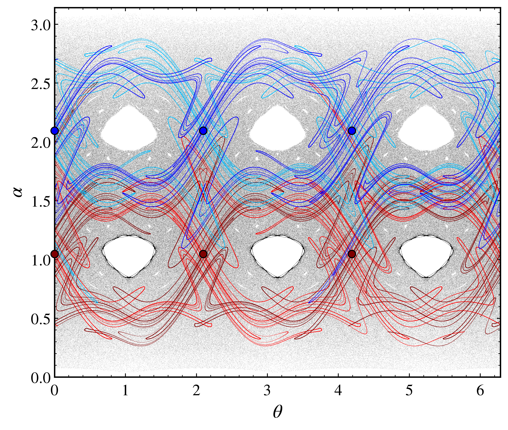

    The two period-3 saddles of the oval with :math:`\varepsilon=0.08` and :math:`p=3`, with :math:`\alpha=\pi/3` (maroon) and :math:`\alpha=2\pi/3` (blue), over a chaotic orbit (black). Each saddle's stable and unstable manifolds are shown in matching shades.

Escape through holes
~~~~~~~~~~~~~~~~~~~~

A hole in the boundary is an interval of the position, for any value of the other coordinate, which ``escape_analysis`` describes with ``hole_size=[h, np.inf]``. See :doc:`Escape dynamics <dds_escape>` for the method. The position wraps at :math:`2\pi` for :math:`\theta` and at the perimeter for an arc length on a closed curve, so a hole at the start of the position also covers its end. On a boundary with separate parts, such as the Sinai billiard, the position does not wrap.

`Hansen et al. (2018) <https://doi.org/10.1016/j.chaos.2017.11.036>`_ studied the oval with :math:`\varepsilon=0.08` and :math:`p=3`. They found faster escape through the hole :math:`h_2\in(3.95,4.15)`, in a chaotic region, than through :math:`h_1\in(3.04,3.24)`, in a region with stability islands. The next figure shows the survival probability of particles injected through each hole.

.. code-block:: python

    import numpy as np
    import matplotlib.pyplot as plt
    from pynamicalsys import Billiard, PlotStyler

    billiard = Billiard("oval", parameters=[0.08, 3], solver="circle")
    hole_size = [0.2, np.inf]
    max_time = 3000
    alphas = np.linspace(0.0, np.pi, 102)[1:-1]

    ps = PlotStyler(fontsize=16)
    ps.apply_style()
    fig, ax = plt.subplots(figsize=(7, 4))
    for name, center in (("$h_1$", 3.14), ("$h_2$", 4.05)):
        thetas = np.linspace(center - 0.1, center + 0.1, 102)[1:-1]
        times = [
            billiard.escape_analysis(
                [theta, alpha],
                max_time,
                exits=[center, 0.0],
                hole_size=hole_size,
            )[1]
            for theta in thetas
            for alpha in alphas
        ]
        n, survival = billiard.survival_probability(times, max_time)
        positive = survival > 0.0
        ax.plot(n[positive], survival[positive], label=name)
    ax.set_yscale("log")
    ax.set_xlim(0, 1000)
    ax.set_xlabel("$n$")
    ax.set_ylabel("$P(n)$")
    ax.legend(frameon=False)
    fig.tight_layout()
    plt.show()

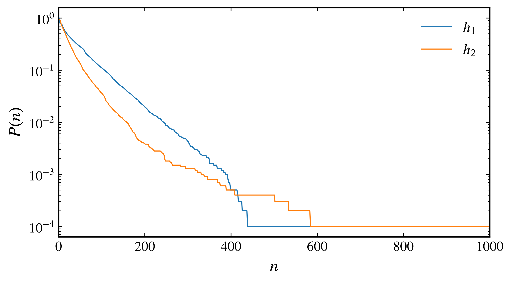

    Survival probability for :math:`10^4` particles injected through each hole.

With two holes open, at :math:`(0.1,0.3)` and :math:`(3.95,4.15)`, the first hole reached defines the escape basins. The next figure shows the region of Fig. 5 of Hansen et al. (2018).

.. code-block:: python

    import numpy as np
    import matplotlib.pyplot as plt
    from pynamicalsys import Billiard, PlotStyler
    from joblib import Parallel, delayed
    from matplotlib.colors import BoundaryNorm, ListedColormap

    billiard = Billiard("oval", parameters=[0.08, 3], solver="circle")
    grid_size = 600
    holes = [[0.2, 0.0], [4.05, 0.0]]
    hole_size = [0.2, np.inf]
    max_time = 2000
    thetas = np.linspace(2.0, 2.2, grid_size)
    alphas = np.linspace(0.001, np.pi - 0.001, grid_size)
    result = Parallel(n_jobs=-1)(
        delayed(billiard.escape_analysis)(
            [theta, alpha], max_time, exits=holes, hole_size=hole_size
        )
        for theta in thetas
        for alpha in alphas
    )
    basin = np.array(result).reshape(grid_size, grid_size, 2)

    ps = PlotStyler(fontsize=16)
    ps.apply_style()
    fig, ax = plt.subplots(1, 2, figsize=(12, 4), sharey=True)
    basin_colors = ListedColormap(["white", "red", "blue"])
    norm = BoundaryNorm([-1.5, -0.5, 0.5, 1.5], basin_colors.N)
    ax[0].pcolormesh(
        thetas,
        alphas,
        basin[:, :, 0].T,
        cmap=basin_colors,
        norm=norm,
        shading="auto",
    )
    times = ax[1].pcolormesh(
        thetas,
        alphas,
        basin[:, :, 1].T,
        cmap="nipy_spectral",
        vmax=80,
        shading="auto",
    )
    fig.colorbar(times, ax=ax[1], label="Escape time")
    ax[0].set_xlabel(r"$\theta$")
    ax[1].set_xlabel(r"$\theta$")
    ax[0].set_ylabel(r"$\alpha$")
    fig.tight_layout()
    plt.show()

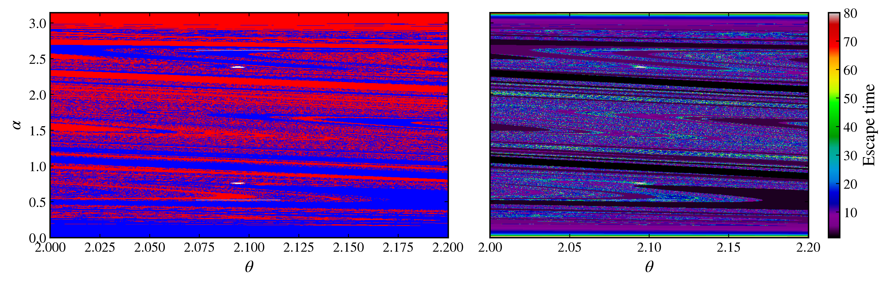

    Escape basins for two holes (red for the first, blue for the second, and white for no escape within ``max_time``), and the number of collisions until escape, with the color scale saturated at 80.

Numerical options
~~~~~~~~~~~~~~~~~

``solver``
    Required. The method that finds the next collision. ``Billiard.available_solvers(name)`` lists those of a built-in billiard, and ``info["available_solvers"]`` those of any billiard. See `Choosing a solver`_.

``md_steps``
    The number of molecular dynamics steps across the diameter of the billiard, used only by ``solver="md"``. The default is ``500``. A collision followed by a return to the interior within one step is not detected.

``coordinates``
    ``"angles"`` for :math:`(q,\alpha)`, or ``"birkhoff"`` for :math:`(s,\cos\alpha)`, where positions and sizes of holes are arc lengths. When the arc length has no closed form, each collision computes it by quadrature, which adds to the cost. Near grazing, :math:`\cos\alpha` resolves :math:`\alpha` only to about :math:`10^{-8}`.

``num_panels``
    The number of Gauss-Legendre panels of the arc length in ``from_polar``, used in Birkhoff coordinates. The default is ``32``. A boundary with sharp features needs more, and a ``UserWarning`` tells when.

``inside``
    An optional function of ``from_pieces`` that tells if a point is inside the billiard, used only by ``solver="md"``. Without it, the test goes through every piece, which is slower than a formula for the shape.

References
~~~~~~~~~~

.. container:: references-list

    - Y\. G\. Sinai, `Dynamical systems with elastic reflections. Ergodic properties of dispersing billiards <https://doi.org/10.1070/RM1970v025n02ABEH003794>`_, Russian Mathematical Surveys 25, 137-189 (1970).
    - L\. A\. Bunimovich, `On the ergodic properties of nowhere dispersing billiards <https://doi.org/10.1007/BF01197884>`_, Communications in Mathematical Physics 65, 295-312 (1979).
    - L\. A\. Bunimovich, `Mushrooms and other billiards with divided phase space <https://doi.org/10.1063/1.1418763>`_, Chaos 11, 802-808 (2001).
    - E\. D\. Leonel and C\. P\. Dettmann, `Recurrence of particles in static and time varying oval billiards <https://doi.org/10.1016/j.physleta.2012.03.056>`_, Physics Letters A 376, 1669-1674 (2012).
    - M\. Hansen, D\. R\. da Costa, I\. L\. Caldas, and E\. D\. Leonel, `Statistical properties for an open oval billiard: An investigation of the escaping basins <https://doi.org/10.1016/j.chaos.2017.11.036>`_, Chaos, Solitons and Fractals 106, 355-362 (2018).
    - D\. R\. da Costa, M\. Hansen, M\. R\. Silva, and E\. D\. Leonel, `Tangent method and some dynamical properties of an oval-like billiard <https://doi.org/10.1142/S0218127422500523>`_, International Journal of Bifurcation and Chaos 32, 2250052 (2022).
    - M\. R\. Sales, D\. Borin, D\. R\. da Costa, J\. D\. Szezech Jr\., and E\. D\. Leonel, `An investigation of escape and scaling properties of a billiard system <https://doi.org/10.1063/5.0222215>`_, Chaos 34, 113122 (2024).
