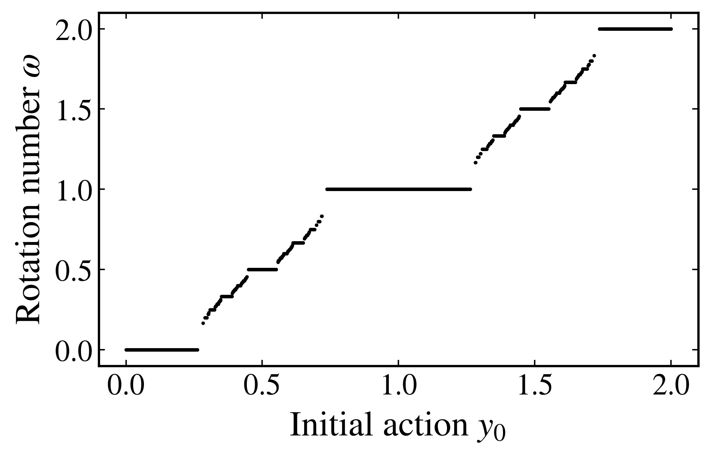
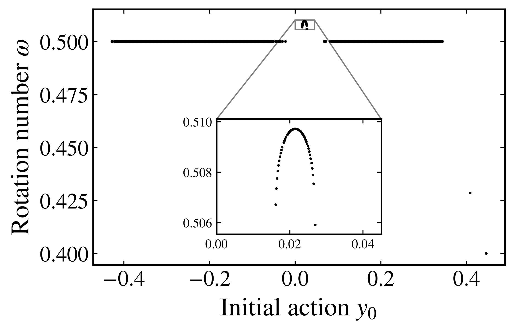
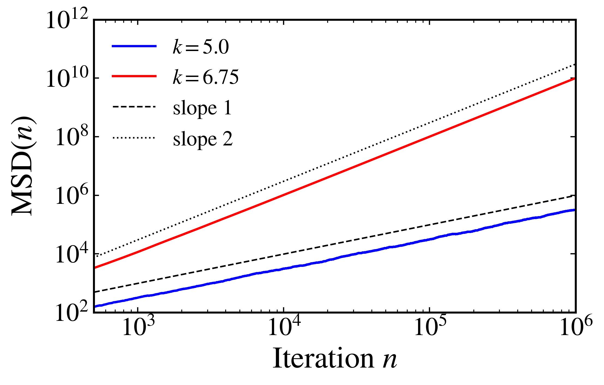
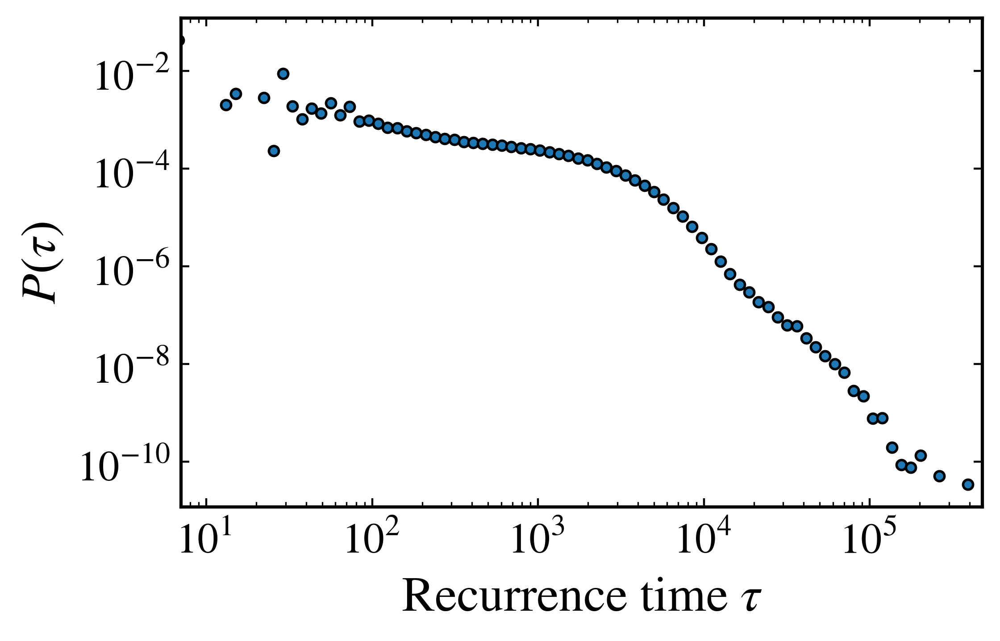

Transport and diffusion
-----------------------

Transport describes how trajectories move through phase space and how an ensemble of initial conditions spreads. In an area-preserving map, invariant curves can block global motion and chaotic trajectories can remain trapped near regular islands for long intervals. The resulting spreading need not follow the linear growth expected for normal diffusion. The standard map has long served as a fundamental model for studying these mechanisms, as reviewed by `Chirikov (1979) <https://doi.org/10.1016/0370-1573(79)90023-1>`_.

Two versions of the standard map are used on this page. The bounded ``standard map`` is used to examine recurrence times. The ``unbounded standard map`` keeps the angle modulo one but allows the action to grow without bounds, making it suitable for measuring rotation numbers and diffusion. The ``standard nontwist map`` illustrates rotation numbers in maps that violate the twist condition.

.. code-block:: python

    import numpy as np
    import matplotlib.pyplot as plt
    from pynamicalsys import DiscreteDynamicalSystem as dds, PlotStyler

Rotation number
~~~~~~~~~~~~~~~

On a cylinder, with an angle :math:`x` and an action :math:`y`, the rotation number of an orbit is the average advance of the angle per iteration. It is written in terms of the frequency map :math:`\Omega`, which gives the advance of the angle, measured in turns on the universal cover, in the iteration that starts at :math:`\mathbf{x}_n=(x_n,y_n)`. Since :math:`x_N-x_0=\sum_{n=0}^{N-1}\Omega(\mathbf{x}_n)`, the rotation number is the time average

.. math::

    \omega=\lim_{N\to\infty}\frac{1}{N}\sum_{n=0}^{N-1}\Omega(\mathbf{x}_n).

For the unbounded standard map, :math:`x_{n+1}=x_n+y_{n+1}` with :math:`y_{n+1}=y_n+k\sin(2\pi x_n)/(2\pi)`, so :math:`\Omega(x,y)=y+k\sin(2\pi x)/(2\pi)`. On a rotational invariant circle, the dynamics is conjugate to a rigid rotation and :math:`\omega` is irrational. An orbit in a chain of :math:`q` islands encircles a periodic orbit of period :math:`q`, and its rotation number averages to that of the periodic orbit, a rational :math:`p/q`. On a chaotic orbit, the time average converges slowly or not at all.

The :py:meth:`rotation_number <pynamicalsys.core.discrete_dynamical_systems.DiscreteDynamicalSystem.rotation_number>` method requires a frequency map. The ``unbounded standard map``, ``standard nontwist map``, ``extended standard nontwist map``, and ``leonel map`` models provide one, and any other map can be given one with :py:meth:`set_frequency_map <pynamicalsys.core.discrete_dynamical_systems.DiscreteDynamicalSystem.set_frequency_map>` or the ``frequency_map`` argument of the constructor. The bounded ``standard map`` does not provide one: there, :math:`y` is also an angle, so the advance of :math:`x` is defined only modulo one turn and no continuous frequency map exists. The rotation number is not reduced modulo one, so orbits whose angles advance by different integer numbers of turns, such as accelerator modes, have different rotation numbers.

By default, the rotation number is computed with the :doc:`weighted Birkhoff average <dds_wba>`, as proposed by `Sander and Meiss (2020) <https://doi.org/10.1016/j.physd.2020.132569>`_. The frequency map is averaged over two consecutive windows of ``total_time`` iterations each, and the rotation number is the mean of the two averages, :math:`\omega=(\omega_0+\omega_1)/2`. On a regular orbit, both averages converge faster than any power of ``total_time``, so they agree in many digits, while on a chaotic orbit they converge as slowly as a plain time average. The number of digits in which they agree,

.. math::

    \mathrm{dig}_\omega=-\log_{10}\left|\omega_0-\omega_1\right|,

therefore separates both cases. If :math:`\mathrm{dig}_\omega` is at least ``threshold``, which is 9 by default, the rotation number is returned. Otherwise, the orbit is considered chaotic and NaN is returned. With ``method="average"``, the plain time average over ``total_time`` iterations is returned instead. It always returns a value, but it converges only as :math:`1/N` on regular orbits and does not distinguish regular from chaotic orbits. The same averages also separate island chains from rotational invariant circles, as shown in the :doc:`weighted Birkhoff average <dds_wba>` guide.

The following example computes the rotation number of the unbounded standard map with :math:`k=0.9` along the line :math:`x_0=0.5`, which crosses the centers of the main island chains:

.. code-block:: python

    system = dds(model="unbounded standard map")
    system.set_parameters([0.9])

    x0 = 0.5
    actions = np.linspace(0.0, 2.0, 2000)
    total_time = 10_000

    omega = np.array([system.rotation_number([x0, y0], total_time) for y0 in actions])

Plot the rotation number as a function of the initial action. Chaotic orbits return NaN and are left out:

.. code-block:: python

    ps = PlotStyler()
    ps.apply_style()
    fig, ax = plt.subplots(figsize=(6, 4))
    ax.plot(actions, omega, "ko", markersize=2, mew=0)
    ax.set_xlabel("Initial action $y_0$")
    ax.set_ylabel(r"Rotation number $\omega$")
    fig.tight_layout()
    plt.savefig(
        f"{path_figures}/standard_map_rotation_number.png", dpi=400, bbox_inches="tight"
    )

    Rotation number of the unbounded standard map with :math:`k=0.9` along the line :math:`x_0=0.5`. Gaps correspond to chaotic orbits.

The rotation number increases with the action. Each island chain crossed by the line produces a plateau at a rational value, and between the plateaus the rotational circles and smaller island chains fill in intermediate values. Since the map is invariant under :math:`y\mapsto y+1` and the angle then advances by one additional turn per iteration, :math:`\omega(x_0,y_0+1)=\omega(x_0,y_0)+1`, and the profile on :math:`[1,2]` repeats that on :math:`[0,1]` shifted by one.

Nontwist maps
^^^^^^^^^^^^^

The standard map satisfies the twist condition: the rotation number of the rotational circles changes monotonically with the action. Nontwist maps violate this condition. A well-studied example is the standard nontwist map of `del-Castillo-Negrete et al. (1996) <https://doi.org/10.1016/0167-2789(95)00257-X>`_,

.. math::

    \begin{aligned}
        y_{n+1}&=y_n-b\sin(2\pi x_n),\\
        x_{n+1}&=x_n+a\left(1-y_{n+1}^2\right)\pmod{1},
    \end{aligned}

whose frequency map is :math:`\Omega(x,y)=a\left[1-\left(y-b\sin(2\pi x)\right)^2\right]`. The rotation number now has an extremum as a function of the action. The rotational circle at which it is attained is the shearless curve, and rotation numbers near the extremum are attained twice, once on each side of the shearless curve.

The same procedure is applied to the standard nontwist map with :math:`a=0.53` and :math:`b=0.45`, along the line :math:`x_0=0.5`. For these parameters, `Mugnaine et al. (2024) <https://doi.org/10.1103/PhysRevE.110.044201>`_ showed that the shearless curve exists between two period-two twin island chains:

.. code-block:: python

    system = dds(model="standard nontwist map")
    system.set_parameters([0.53, 0.45])

    x0 = 0.5
    actions = np.linspace(-0.5, 0.5, 5000)

    omega = np.array([system.rotation_number([x0, y0], total_time) for y0 in actions])

The maximum of the profile is small compared with the range of the plot, so an inset magnifies it:

.. code-block:: python

    ps = PlotStyler()
    ps.apply_style()
    fig, ax = plt.subplots(figsize=(6, 4))
    ax.plot(actions, omega, "ko", markersize=2, mew=0)
    ax.set_xlabel("Initial action $y_0$")
    ax.set_ylabel(r"Rotation number $\omega$")

    window = (actions > 0.0) & (actions < 0.045) & (omega > 0.5)
    axins = ax.inset_axes([0.3, 0.12, 0.4, 0.45])
    axins.plot(actions[window], omega[window], "ko", markersize=2, mew=0)
    axins.set_xlim(0.0, 0.045)
    margin = 0.1 * (omega[window].max() - omega[window].min())
    axins.set_ylim(omega[window].min() - margin, omega[window].max() + margin)
    axins.tick_params(labelsize=10)
    ax.indicate_inset_zoom(axins, edgecolor="k")

    fig.tight_layout()
    plt.savefig(
        f"{path_figures}/standard_nontwist_map_rotation_number.png",
        dpi=400,
        bbox_inches="tight",
    )

    Rotation number of the standard nontwist map with :math:`a=0.53` and :math:`b=0.45` along the line :math:`x_0=0.5`. The inset magnifies the neighborhood of the shearless curve.

Most initial conditions on this line lie in the two period-two twin island chains, with :math:`\omega=1/2`, one on each side of the shearless curve. Between them, the inset shows the rotational circles around the shearless curve. Their rotation number rises to a maximum, attained on the shearless curve, and decreases again, so the profile is nonmonotonic.

Diffusion of an ensemble
~~~~~~~~~~~~~~~~~~~~~~~~

When the action is unbounded, an ensemble of initial conditions can spread indefinitely. The central quantity is the mean squared displacement of the action,

.. math::

    \mathrm{MSD}(n)=\left\langle\left(y_n-y_0\right)^2\right\rangle,

where the average is taken over the ensemble. Normal diffusion satisfies :math:`\mathrm{MSD}(n)\sim 2Dn`, while anomalous diffusion follows :math:`\mathrm{MSD}(n)\sim n^\gamma` with :math:`\gamma\neq1`. Accelerator modes can produce ballistic motion with :math:`\gamma=2` and strongly influence the surrounding chaotic transport, as discussed by `Karney et al. (1982) <https://doi.org/10.1016/0167-2789(82)90045-8>`_ and `Karney (1983) <https://doi.org/10.1016/0167-2789(83)90232-4>`_.

The :py:meth:`mean_squared_displacement <pynamicalsys.core.discrete_dynamical_systems.DiscreteDynamicalSystem.mean_squared_displacement>` method follows an ensemble and measures the displacement along the coordinate selected by ``axis``. Here, 900 initial conditions are distributed across the unit square and the action is measured with ``axis=1``:

.. code-block:: python

    system = dds(model="unbounded standard map")

    rng = np.random.default_rng(0)
    num_ic = 30 * 30
    x0 = np.random.uniform(0, 1, num_ic)
    y0 = np.random.uniform(0, 1, num_ic)
    initial_conditions = np.column_stack([x0, y0])
    total_time = int(1e6)

    k1 = 5.0
    system.set_parameters([k1])
    msd_normal = system.mean_squared_displacement(initial_conditions, total_time, axis=1)

    k2 = 6.75
    system.set_parameters([k2])
    msd_anomalous = system.mean_squared_displacement(initial_conditions, total_time, axis=1)

Each call returns a one-dimensional array of length ``total_time``, containing the mean squared displacement from iteration 1 through ``total_time``. At :math:`k=5.0`, the growth is approximately linear. At :math:`k=6.75`, an accelerator mode produces nearly ballistic spreading.

.. code-block:: python

    time = np.arange(1, total_time + 1)
    ps = PlotStyler()
    ps.apply_style()
    fig, ax = plt.subplots(figsize=(6, 4))
    ax.loglog(time, msd_normal, "b", label=f"$k = {k1}$", lw=1.5)
    ax.loglog(time, msd_anomalous, "r", label=f"$k = {k2}$", lw=1.5)
    ax.loglog(time, 3 * msd_normal[0] * time, "k--", lw=1, label=r"slope $1$")
    ax.loglog(time, 0.03 * time**2, "k:", lw=1, label=r"slope $2$")
    ax.set_xlabel("Iteration $n$")
    ax.set_ylabel(r"$\mathrm{MSD}(n)$")
    ax.set_ylim(1e2, 1e12)
    ax.set_xlim(5e2, total_time)
    ax.legend(frameon=False)
    fig.tight_layout()
    plt.savefig(
        f"{path_figures}/standard_map_diffusion_msd.png", dpi=400, bbox_inches="tight"
    )

    Mean squared displacement of the action for the unbounded standard map. The curve for :math:`k=5.0` follows the slope-one reference for normal diffusion, while the curve for :math:`k=6.75` approaches the slope-two reference for ballistic transport.

Diffusion coefficient
^^^^^^^^^^^^^^^^^^^^^

For normal diffusion, the :py:meth:`diffusion_coefficient <pynamicalsys.core.discrete_dynamical_systems.DiscreteDynamicalSystem.diffusion_coefficient>` method estimates :math:`D` from the final ensemble displacement through the Einstein relation :math:`D\approx\mathrm{MSD}(N)/(2N)`. Analytical corrections to the random-phase approximation for the Chirikov-Taylor map were developed by `Rechester et al. (1981) <https://doi.org/10.1103/PhysRevA.23.2664>`_.

For the normalization used by **pynamicalsys**, uncorrelated angle kicks have variance :math:`k^2/(8\pi^2)`, giving the random-phase estimate

.. math::

    D_{\mathrm{QL}}=\frac{k^2}{16\pi^2}.

The measured coefficient at :math:`k=5.0` is close to this estimate:

.. code-block:: python

    system.set_parameters([5.0])
    D = system.diffusion_coefficient(initial_conditions, total_time, axis=1)
    print("measured D:", float(D))
    print("random-phase D:", 5.0**2 / (16 * np.pi**2))

.. code-block:: text

    measured D: 0.1575283354658878
    random-phase D: 0.15831434944115277

A single diffusion coefficient is meaningful only when the mean squared displacement is asymptotically linear. For anomalous transport, :math:`\mathrm{MSD}(N)/(2N)` depends on the observation time and the spreading must instead be characterized by the exponent :math:`\gamma`.

Summaries of the ensemble
^^^^^^^^^^^^^^^^^^^^^^^^^

Several methods summarize the same ensemble along the selected ``axis`` and can optionally record only chosen ``sample_times``. The :py:meth:`average_in_time <pynamicalsys.core.discrete_dynamical_systems.DiscreteDynamicalSystem.average_in_time>` method returns the ensemble mean of the coordinate at each sampled time. The :py:meth:`cumulative_average <pynamicalsys.core.discrete_dynamical_systems.DiscreteDynamicalSystem.cumulative_average>` method returns its cumulative time average. The :py:meth:`root_mean_squared <pynamicalsys.core.discrete_dynamical_systems.DiscreteDynamicalSystem.root_mean_squared>` method gives the root mean square accumulated over time, which measures the typical width of the ensemble.

.. code-block:: python

    system.set_parameters([5.0])
    mean = system.average_in_time(initial_conditions, total_time, axis=1)
    rms = system.root_mean_squared(initial_conditions, total_time, axis=1)

The :py:meth:`ensemble_time_average <pynamicalsys.core.discrete_dynamical_systems.DiscreteDynamicalSystem.ensemble_time_average>` method returns one centered time average per trajectory. Each trajectory average has the ensemble mean subtracted, so the returned values quantify trajectory-to-trajectory fluctuations around the ensemble average.

.. code-block:: python

    eta = system.ensemble_time_average(initial_conditions, total_time, axis=1)
    print(eta.shape, round(float(eta.mean()), 3), round(float(eta.std()), 3))

.. code-block:: text

    (5000,) 0.0 10.292

Recurrence times and stickiness
~~~~~~~~~~~~~~~~~~~~~~~~~~~~~~~

For a measure-preserving map on a bounded phase space, the Poincaré recurrence theorem guarantees that almost every initial condition eventually returns arbitrarily close to its starting point. In a mixed phase space, trajectories can remain close to regular islands for long intervals before returning. These trapping episodes generate long-time correlations and heavy recurrence-time tails, as studied for the standard map by `Chirikov and Shepelyansky (1999) <https://doi.org/10.1103/PhysRevLett.82.528>`_.

The :py:meth:`recurrence_times <pynamicalsys.core.discrete_dynamical_systems.DiscreteDynamicalSystem.recurrence_times>` method records the number of iterations between successive entries into a hypercube centered on the initial state. The argument ``eps`` gives the side length of this recurrence neighborhood. An optional ``transient_time`` can be used to evolve the initial condition before defining its center.

.. code-block:: python

    system = dds(model="standard map")
    system.set_parameters([1.5])
    times = system.recurrence_times([0.2, 0.02], 1_000_000_000, eps=0.02)
    print(times.size, times.min(), times.max(), times.mean())

.. code-block:: text

    561463 7.0 475852.0 1781.0521405684792

The observed return times range from 7 iterations to more than 475,000 iterations. Their mean is much smaller than their maximum, indicating a broad distribution generated by long trapping episodes.

.. code-block:: python

    counts, edges = np.histogram(
        times, bins=np.logspace(0, np.log10(times.max()), 100), density=True
    )
    centers = np.sqrt(edges[:-1] * edges[1:])

    ps = PlotStyler()
    ps.apply_style()
    fig, ax = plt.subplots(figsize=(6, 4))
    ax.loglog(centers, counts, "o", markersize=4)
    ax.set_xlabel(r"Recurrence time $\tau$")
    ax.set_ylabel(r"$P(\tau)$")
    ax.set_xlim(times.min(), times.max())
    fig.tight_layout()
    plt.savefig(
        f"{path_figures}/standard_map_recurrence_times.png", dpi=400, bbox_inches="tight"
    )

    Recurrence-time distribution for the standard map with :math:`k=1.5`. The long tail reflects trapping near regular structures in the mixed phase space.

Recurrence times measure the intervals between visits to a neighborhood. The :doc:`recurrence time entropy <dds_rte>` instead measures the diversity of recurrence periods obtained from a recurrence plot, so the two quantities provide complementary descriptions of recurrent dynamics.

Numerical options
~~~~~~~~~~~~~~~~~

``method`` and ``threshold`` of ``rotation_number``
    ``method="wba"``, the default, iterates the orbit ``2 * total_time`` times and returns NaN when the two windows agree in fewer than ``threshold`` digits, by default ``9``. Lowering ``threshold`` accepts rotation numbers of orbits that have not fully converged, such as those near the edge of an island, at the cost of misclassifying some chaotic orbits as regular. ``method="average"`` iterates ``total_time`` times and always returns a value. The ``mod`` argument is deprecated and is used only when no frequency map is set.

``axis``
    The index of the coordinate whose displacement or average is measured, by default ``1``, which is the action in the maps above.

``sample_times``
    The iterations at which ``mean_squared_displacement``, ``average_in_time``, ``cumulative_average``, and ``root_mean_squared`` record their values. By default every iteration from ``1`` to ``total_time`` is recorded, so the output has ``total_time`` entries. For long runs, a logarithmically spaced set of integers keeps the output small without losing the shape of a log-log plot. ``diffusion_coefficient`` and ``ensemble_time_average`` use only the final state and the full time average, respectively, and do not accept it.

``eps``, ``transient_time``, and ``periods`` of ``recurrence_times``
    ``eps``, by default ``1e-2``, is the full side length of the recurrence box, so each coordinate must return within ``eps / 2`` of the reference point. A smaller box gives longer and rarer recurrences and needs a larger ``total_time`` to collect enough of them. ``transient_time`` iterations are performed before the reference point is defined and are not counted in ``total_time``. ``periods`` gives the wrapping period of each coordinate, with ``np.inf`` for coordinates that do not wrap, for example ``periods=[1.0, 1.0]`` for the standard map. The distance to the reference point is then measured modulo the period, so the box wraps around the boundaries of the periodic coordinates. Without ``periods``, no coordinate wraps, and reference points closer than ``eps / 2`` to a boundary miss the returns on the other side.

References
~~~~~~~~~~

.. container:: references-list

    - B\. V\. Chirikov, `A universal instability of many-dimensional oscillator systems <https://doi.org/10.1016/0370-1573(79)90023-1>`_, Physics Reports 52, 263-379 (1979).
    - A\. B\. Rechester, M\. N\. Rosenbluth, and R\. B\. White, `Fourier-space paths applied to the calculation of diffusion for the Chirikov-Taylor model <https://doi.org/10.1103/PhysRevA.23.2664>`_, Physical Review A 23, 2664-2672 (1981).
    - C\. F\. F\. Karney, A\. B\. Rechester, and R\. B\. White, `Effect of noise on the standard mapping <https://doi.org/10.1016/0167-2789(82)90045-8>`_, Physica D 4, 425-438 (1982).
    - C\. F\. F\. Karney, `Long-time correlations in the stochastic regime <https://doi.org/10.1016/0167-2789(83)90232-4>`_, Physica D 8, 360-380 (1983).
    - D\. del-Castillo-Negrete, J\. M\. Greene, and P\. J\. Morrison, `Area preserving nontwist maps: periodic orbits and transition to chaos <https://doi.org/10.1016/0167-2789(95)00257-X>`_, Physica D 91, 1-23 (1996).
    - B\. V\. Chirikov and D\. L\. Shepelyansky, `Asymptotic statistics of Poincaré recurrences in Hamiltonian systems with divided phase space <https://doi.org/10.1103/PhysRevLett.82.528>`_, Physical Review Letters 82, 528-531 (1999).
    - E\. Sander and J\. D\. Meiss, `Birkhoff averages and rotational invariant circles for area-preserving maps <https://doi.org/10.1016/j.physd.2020.132569>`_, Physica D 411, 132569 (2020).
    - M\. Mugnaine, J\. D\. Szezech Jr\., R\. L\. Viana, I\. L\. Caldas, and P\. J\. Morrison, `Shearless effective barriers to chaotic transport induced by even twin islands in nontwist systems <https://doi.org/10.1103/PhysRevE.110.044201>`_, Physical Review E 110, 044201 (2024).
