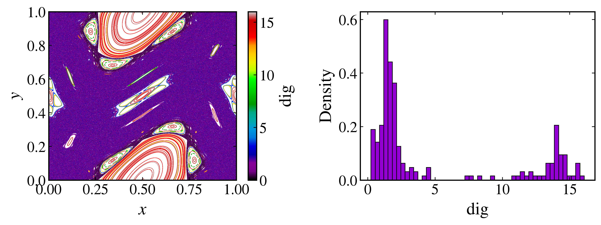
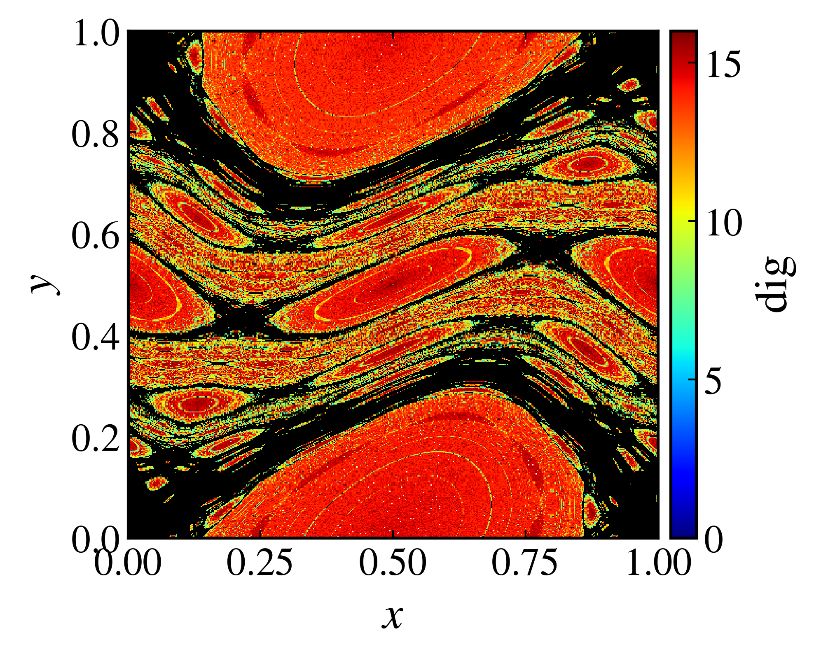
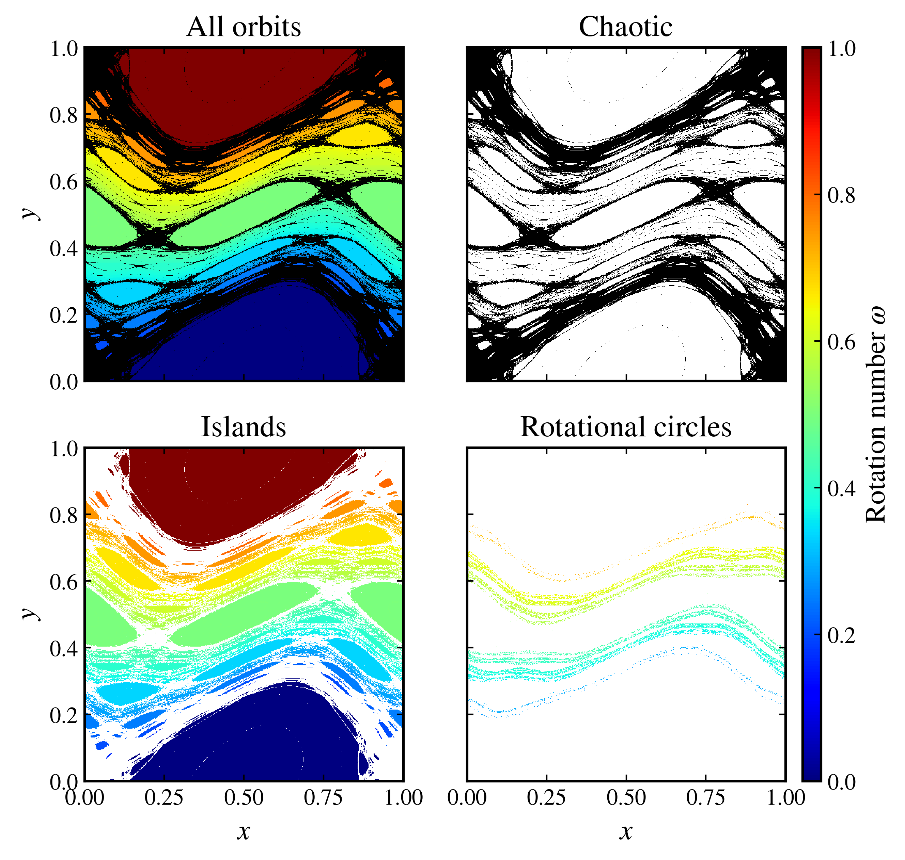

Weighted Birkhoff average
~~~~~~~~~~~~~~~~~~~~~~~~~

The weighted Birkhoff average (WBA) was introduced by `Das et al. (2016) <https://doi.org/10.1209/0295-5075/114/40005>`_ to accelerate the convergence of time averages on quasiperiodic trajectories. Its numerical properties and applications were developed further by `Das et al. (2017) <https://doi.org/10.1088/1361-6544/aa84c2>`_, while the superconvergence result was established by `Das and Yorke (2018) <https://doi.org/10.1088/1361-6544/aa99a0>`_.

For a discrete dynamical system :math:`\mathbf{x}_{n+1}=\mathbf{M}(\mathbf{x}_n)` and a smooth observable :math:`h`, the ordinary Birkhoff average over :math:`N` iterations is

.. math::

    B_N(h)(\mathbf{x}_0)=\frac{1}{N}\sum_{n=0}^{N-1}h\!\left(\mathbf{M}^n(\mathbf{x}_0)\right).

The WBA replaces the uniform weights by a smooth bump that suppresses contributions near both ends of the trajectory:

.. math::

    \mathrm{WB}_N(h)(\mathbf{x}_0)=\sum_{n=0}^{N-1}w_{n,N}h\!\left(\mathbf{M}^n(\mathbf{x}_0)\right),

where

.. math::

    w_{n,N}=\frac{g(n/N)}{\displaystyle\sum_{j=0}^{N-1}g(j/N)},

and

.. math::

    g(t)=
    \begin{cases}
        \exp\!\left[-\dfrac{1}{t(1-t)}\right], & 0<t<1, \\
        0, & \text{otherwise}.
    \end{cases}

For a sufficiently smooth quasiperiodic trajectory with a Diophantine rotation vector, a smooth map, and a smooth observable, the error decreases faster than any inverse power of :math:`N`. More precisely, for every positive integer :math:`m`, there is a constant :math:`C_m` such that

.. math::

    \left|\mathrm{WB}_N(h)(\mathbf{x}_0)-\int h\,\mathrm{d}\mu\right|\leq C_mN^{-m}.

This accelerated convergence does not generally occur for chaotic trajectories. The difference between two consecutive WBA windows can therefore be used to distinguish quasiperiodic and chaotic dynamics.

The dig indicator
^^^^^^^^^^^^^^^^^

The :math:`\mathrm{dig}` indicator compares two consecutive windows of length :math:`N`, as proposed for orbit classification by `Sander and Meiss (2020) <https://doi.org/10.1016/j.physd.2020.132569>`_:

.. math::

    \mathrm{dig}=-\log_{10}\left|\mathrm{WB}_N(h)(\mathbf{x}_0)-\mathrm{WB}_N(h)(\mathbf{x}_N)\right|.

A large value means that the two averages agree to many decimal digits and is characteristic of a well-resolved quasiperiodic trajectory. A small value indicates slow convergence and is characteristic of a chaotic trajectory, although sticky chaotic trajectories may require much longer windows before they are identified. Small values should not be interpreted as a ranking of how chaotic different trajectories are.

The separation between regular and chaotic values depends on the system, observable, window length, and numerical precision. For example, `Sales et al. (2022) <https://doi.org/10.1016/j.physleta.2022.127991>`_ found two modes near :math:`\mathrm{dig}=14` and :math:`\mathrm{dig}=3.5` for a particular standard-map computation and used :math:`11.25` as an empirical threshold. That value is specific to that calculation and is not a universal cutoff.

In :py:meth:`dig <pynamicalsys.core.discrete_dynamical_systems.DiscreteDynamicalSystem.dig>`, ``total_time`` is the length :math:`N` of each window, so the trajectory is iterated :math:`2N` times. If ``transient_time`` is supplied, those iterations are discarded first.

Classifying the standard map
^^^^^^^^^^^^^^^^^^^^^^^^^^^^

The following example samples initial conditions for the standard map and evaluates :math:`\mathrm{dig}` with the default observable :math:`h(x,y)=\cos(2\pi x)`:

.. code-block:: python

    import numpy as np
    import matplotlib.pyplot as plt
    from pynamicalsys import DiscreteDynamicalSystem as dds, PlotStyler

    system = dds(model="standard map")
    system.set_parameters([1.5])

    rng = np.random.default_rng(1312)
    num_initial_conditions = 200
    initial_states = rng.uniform(0.0, 1.0, size=(num_initial_conditions, 2))
    total_time = 10_000

    digs = np.array(
        [
            system.dig(
                u=initial_state,
                total_time=total_time,
            )
            for initial_state in initial_states
        ]
    )

    trajectory_time = 10_000
    trajectories = system.trajectory(
        u=initial_states,
        total_time=trajectory_time,
    ).reshape(num_initial_conditions, trajectory_time, 2)

Plot every trajectory with the color assigned by the :math:`\mathrm{dig}` value of its initial condition, together with the distribution of finite values. The shorter ``trajectory_time`` controls only the phase-space visualization and does not change the WBA windows used for the classification:

.. code-block:: python

    finite_digs = digs[np.isfinite(digs)]
    trajectory_digs = np.repeat(digs, trajectory_time)

    ps = PlotStyler()
    ps.apply_style()
    fig, ax = plt.subplots(1, 2, figsize=(10, 4))
    points = ax[0].scatter(
        trajectories[:, :, 0].ravel(),
        trajectories[:, :, 1].ravel(),
        c=trajectory_digs,
        s=0.1,
        edgecolor="none",
        cmap="nipy_spectral",
        vmin=0,
        vmax=16,
    )
    ax[0].set_xlim(0.0, 1.0)
    ax[0].set_ylim(0.0, 1.0)
    ax[0].set_xlabel("$x$")
    ax[0].set_ylabel("$y$")
    fig.colorbar(points, ax=ax[0], label=r"$\mathrm{dig}$")
    ax[1].hist(
        finite_digs,
        bins=50,
        density=True,
        color="darkviolet",
        edgecolor="black",
        linewidth=0.75,
    )
    ax[1].set_xlabel(r"$\mathrm{dig}$")
    ax[1].set_ylabel("Density")
    fig.tight_layout()
    plt.show()

    Standard-map trajectories colored by their weighted-Birkhoff classification and the corresponding distribution of :math:`\mathrm{dig}` values.

The high-value mode is associated with regular islands, while the low-value mode is associated with the chaotic sea. Points near island boundaries may be sticky, so increasing ``total_time`` is an important robustness check.

Choosing an observable
^^^^^^^^^^^^^^^^^^^^^^

The observable is a function of a single state, an array of shape ``(system_dimension,)``, that returns a real number. It is compiled with Numba when possible and is evaluated as a plain Python function otherwise, which is slower. The default observable, :math:`h=\cos(2\pi u_0/T)`, assumes that the first coordinate :math:`u_0` is an angle with period :math:`T`, given by ``period`` (1 by default). For an angle in radians, ``period=2 * np.pi`` gives :math:`h=\cos u_0`. The observable should be smooth and nonconstant on the region being studied. For example, the default observable can be replaced by :math:`h(x,y)=\sin[2\pi(x+y)]`:

.. code-block:: python

    observable = lambda u: np.sin(2.0 * np.pi * (u[0] + u[1]))

    custom_dig = system.dig(
        u=initial_states[0],
        total_time=total_time,
        func=observable,
    )

The observable is not unique, but a nearly constant or symmetry-degenerate choice can conceal the distinction of interest. When the classification is important, compare more than one smooth observable and increase the window length to confirm that the conclusion is stable.

Island chains and rotational circles
^^^^^^^^^^^^^^^^^^^^^^^^^^^^^^^^^^^^

Besides separating regular from chaotic orbits, the weighted Birkhoff average gives an accurate :doc:`rotation number <dds_transport>`, which separates the two types of regular orbits: it is rational on island chains and irrational on rotational invariant circles. Following `Sander and Meiss (2020) <https://doi.org/10.1016/j.physd.2020.132569>`_, rationality is decided numerically from the smallest denominator :math:`q_{\min}` of a rational within :math:`\delta=10^{-\mathrm{tol}}` of :math:`\omega`. For a typical irrational number, :math:`\log_{10}q_{\min}` is close to :math:`\mathrm{tol}/2`, while a rational with a small denominator gives a much smaller value. The orbit lies on a rotational circle if

.. math::

    \left|\log_{10}q_{\min}-\frac{\mathrm{tol}}{2}\right|<\mathrm{dev}_{\mathrm{c}},

and in an island chain otherwise. The defaults :math:`\mathrm{tol}=8` and :math:`\mathrm{dev}_{\mathrm{c}}=0.3375` are those of Sander and Meiss. They are conservative: some rotational circles are reported as islands, but island orbits are rarely reported as circles.

The :py:meth:`classify_orbit <pynamicalsys.core.discrete_dynamical_systems.DiscreteDynamicalSystem.classify_orbit>` method combines this test with the :math:`\mathrm{dig}` indicator of an observable :math:`h`. It requires a frequency map, so the example below uses the ``unbounded standard map``, which provides one. Like :py:meth:`dig <pynamicalsys.core.discrete_dynamical_systems.DiscreteDynamicalSystem.dig>`, it compares two consecutive windows of ``total_time`` iterations each, and it also returns the number of converged digits of the rotation number, :math:`\mathrm{dig}_\omega`. An orbit with :math:`\mathrm{dig}` at least ``dig_threshold``, which is 5.5 by default, is regular and is classified by the test above. An orbit with a smaller :math:`\mathrm{dig}` is still classified as an island if its rotation number has converged (:math:`\mathrm{dig}_\omega` at least ``omega_threshold``) and is a rational with a small denominator, which covers island orbits on which the average of :math:`h` converges slowly. All other orbits are chaotic. The default observable is :math:`h=\cos(2\pi u_0/T)`, where the first coordinate :math:`u_0` is assumed to be the angle and :math:`T` is its period, given by ``period`` (1 by default). For other systems, pass the observable as ``func``.

To see where each type of orbit lies, classify a grid of initial conditions covering one period of both coordinates of the unbounded standard map, :math:`[0,1)\times[0,1)`. For a map whose coordinates are taken modulo :math:`2\pi`, the grid would cover :math:`[0,2\pi)\times[0,2\pi)` instead. With a :math:`500\times500` grid, the computation takes a few minutes:

.. code-block:: python

    system = dds(model="unbounded standard map")
    system.set_parameters([0.9])

    total_time = 10_000
    grid_size = 500
    x = np.linspace(0.0, 1.0, grid_size, endpoint=False)
    y = np.linspace(0.0, 1.0, grid_size, endpoint=False)
    X, Y = np.meshgrid(x, y)

    classes = np.empty(X.shape, dtype="<U7")
    omega = np.empty(X.shape)
    dig = np.empty(X.shape)
    for i in range(grid_size):
        for j in range(grid_size):
            result = system.classify_orbit([X[i, j], Y[i, j]], total_time)
            classes[i, j] = result["classification"]
            omega[i, j] = result["rotation_number"]
            dig[i, j] = result["dig"]

First, plot :math:`\mathrm{dig}`, the number of digits in which the weighted Birkhoff averages of the observable agree over the two windows, as in Fig. 4 of `Sander and Meiss (2020) <https://doi.org/10.1016/j.physd.2020.132569>`_. Initial conditions with :math:`\mathrm{dig}` below ``dig_threshold`` are shown in black:

.. code-block:: python

    dig_threshold = 5.5
    below = np.where(dig < dig_threshold, 1.0, np.nan)
    above = np.where(dig >= dig_threshold, dig, np.nan)

    ps = PlotStyler()
    ps.apply_style()
    fig, ax = plt.subplots(figsize=(5, 4))
    mesh = ax.pcolormesh(x, y, above, cmap="jet", vmin=0.0, vmax=16.0, shading="auto")
    ax.pcolormesh(x, y, below, cmap="Greys", vmin=0.0, vmax=1.0, shading="auto")
    ax.set_xlim(0.0, 1.0)
    ax.set_ylim(0.0, 1.0)
    ax.set_xlabel("$x$")
    ax.set_ylabel("$y$")
    fig.colorbar(mesh, ax=ax, label=r"$\mathrm{dig}$", pad=0.02)
    plt.savefig(f"{path_figures}/standard_map_dig_grid.png", dpi=400, bbox_inches="tight")

    Number of converged digits of the weighted Birkhoff average of :math:`h=\cos(2\pi x)` for a :math:`500\times500` grid of initial conditions of the unbounded standard map with :math:`k=0.9`. Initial conditions with :math:`\mathrm{dig}<5.5` are shown in black.

On regular orbits, the two averages agree to a large number of digits, limited by double precision, while on chaotic orbits they agree to only a few. The black region is therefore the chaotic set, apart from island orbits on which the average of the observable converges slowly, which :py:meth:`classify_orbit <pynamicalsys.core.discrete_dynamical_systems.DiscreteDynamicalSystem.classify_orbit>` recovers from the convergence of the rotation number.

Then plot the classification, with all orbits together and each type separately. Regular orbits are colored by their rotation number and chaotic orbits are shown in black:

.. code-block:: python

    chaotic = np.where(classes == "chaotic", 1.0, np.nan)

    ps = PlotStyler(fontsize=15)
    ps.apply_style()
    fig, ax = plt.subplots(2, 2, figsize=(8, 7), sharex=True, sharey=True)
    panels = [
        (ax[0, 0], omega, True, "All orbits"),
        (ax[0, 1], None, True, "Chaotic"),
        (ax[1, 0], np.where(classes == "island", omega, np.nan), False, "Islands"),
        (
            ax[1, 1],
            np.where(classes == "circle", omega, np.nan),
            False,
            "Rotational circles",
        ),
    ]
    for axis, values, show_chaos, title in panels:
        if values is not None:
            mesh = axis.pcolormesh(
                x, y, values, cmap="jet", vmin=0.0, vmax=1.0, shading="auto"
            )
        if show_chaos:
            axis.pcolormesh(x, y, chaotic, cmap="Greys", vmin=0.0, vmax=1.0, shading="auto")
        axis.set_title(title, fontsize=16)
        axis.set_xlim(0.0, 1.0)
        axis.set_ylim(0.0, 1.0)
    for axis in ax[1, :]:
        axis.set_xlabel("$x$")
    for axis in ax[:, 0]:
        axis.set_ylabel("$y$")
    fig.colorbar(mesh, ax=ax, label=r"Rotation number $\omega$", aspect=40, pad=0.02)
    plt.savefig(
        f"{path_figures}/standard_map_orbit_classification.png",
        dpi=400,
        bbox_inches="tight",
    )

    Classification of a :math:`500\times500` grid of initial conditions of the unbounded standard map with :math:`k=0.9`. Regular orbits are colored by their rotation number and chaotic orbits are shown in black.

Island chains appear as regions of constant color, since every orbit in a chain has the same rational rotation number. Rotational circles span the whole range of the angle and their rotation number increases with the action. The chaotic orbits lie in the layers around the separatrices of the island chains. Some orbits that span the whole range of the angle appear in the island panel. They can be island chains of high period, which the grid does not resolve, or rotational circles whose rotation number is close to a rational with a small denominator, which the conservative choice of :math:`\mathrm{dev}_{\mathrm{c}}` classifies as islands.

References
^^^^^^^^^^

.. container:: references-list

    - S\. Das, C\. B\. Dock, Y\. Saiki, M\. Salgado-Flores, E\. Sander, J\. Wu, and J\. A\. Yorke, `Measuring quasiperiodicity <https://doi.org/10.1209/0295-5075/114/40005>`_, Europhysics Letters 114, 40005 (2016).
    - S\. Das, Y\. Saiki, E\. Sander, and J\. A\. Yorke, `Quantitative quasiperiodicity <https://doi.org/10.1088/1361-6544/aa84c2>`_, Nonlinearity 30, 4111-4140 (2017).
    - S\. Das and J\. A\. Yorke, `Super convergence of ergodic averages for quasiperiodic orbits <https://doi.org/10.1088/1361-6544/aa99a0>`_, Nonlinearity 31, 491-501 (2018).
    - E\. Sander and J\. D\. Meiss, `Birkhoff averages and rotational invariant circles for area-preserving maps <https://doi.org/10.1016/j.physd.2020.132569>`_, Physica D 411, 132569 (2020).
    - M\. R\. Sales, M\. Mugnaine, R\. L\. Viana, I\. L\. Caldas, and J\. D\. Szezech Jr., `Unpredictability in Hamiltonian systems with a hierarchical phase space <https://doi.org/10.1016/j.physleta.2022.127991>`_, Physics Letters A 431, 127991 (2022).
